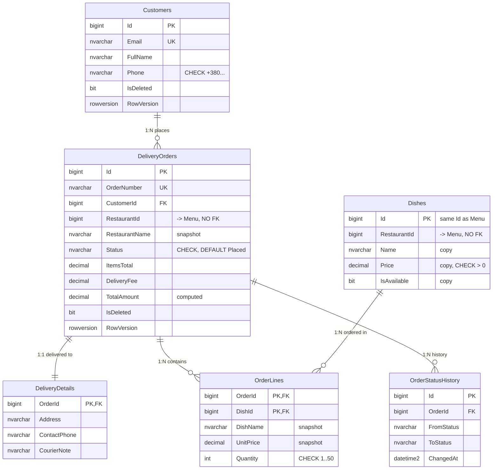
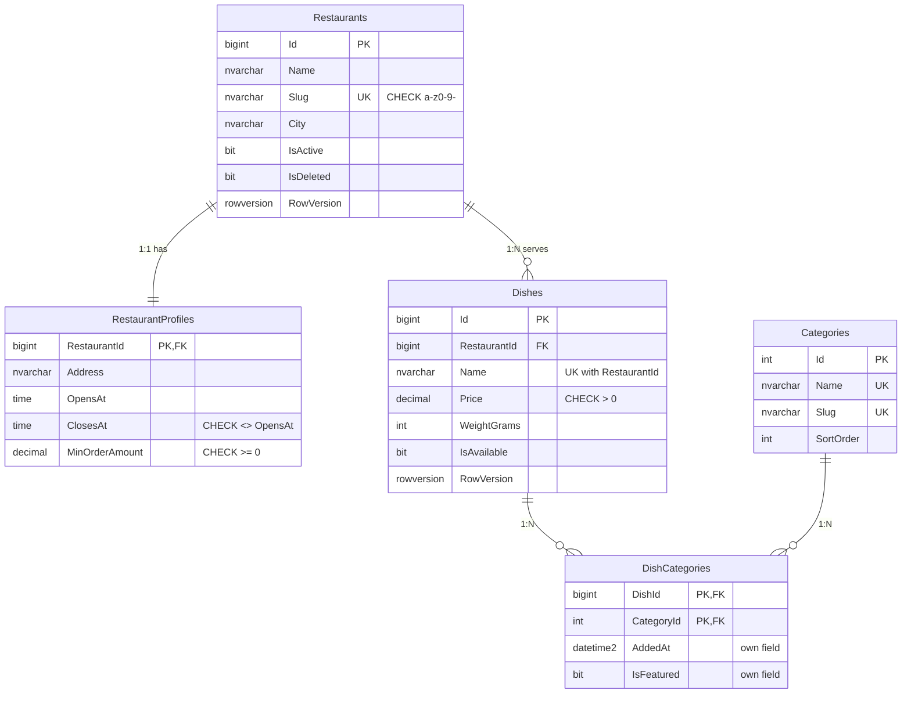

# SmakoViz — сервіс доставки їжі (мікросервісна платформа)

Наскрізний проєкт курсу «Технології .NET у сучасній веб-інженерії».
**Лаб. 01 — проєктування баз даних для мікросервісної архітектури.**

## 1. Предметна область

**SmakoViz** — міський сервіс доставки їжі з ресторанів Чернівців.
Клієнт обирає ресторан і страви, оформлює замовлення з адресою доставки, оплачує його,
ресторан готує, кур'єр привозить. Після доставки клієнт залишає відгуки про страви,
ресторан і кур'єра та спілкується з рестораном в обговореннях.
Мета системи — швидке оформлення замовлення, прозорий статус доставки і чесні оцінки ресторанів.

## 2. Три незалежні контексти (Bounded Contexts)

Кожен контекст = окремий мікросервіс = **власна база даних**. Між базами немає ні спільних таблиць,
ні `FOREIGN KEY`, ні JOIN-ів — лише посилання за ідентифікатором.

| # | Контекст | БД / технологія | Власні сутності (належать **тільки** йому) | Чому така технологія |
|---|----------|-----------------|---------------------------------------------|----------------------|
| 1 | **Доставка** (DeliveryOrders) | `SmakoViz_Delivery` · SQL Server · ADO.NET + Dapper | Customer, DeliveryOrder, DeliveryDetails, OrderLine, OrderStatusHistory (+ локальна копія Dish) | Замовлення — транзакційний процес зі строгими статусами: потрібні транзакції, збережувані процедури, перевірка цілісності |
| 2 | **Меню** (Menu) | `SmakoViz_Menu` · SQL Server · EF Core Code First | Restaurant, RestaurantProfile, Dish, Category, DishCategory | Багато пов'язаних сутностей і всі типи зв'язків — зручно для Fluent API, міграцій і seed-даних |
| 3 | **Відгуки** (Feedback) | `smakoviz_feedback` · MongoDB | Review, Discussion, Message, RatingSummary | Відгуки різних типів мають різну структуру, вкладені коментарі, довгі обговорення — природно лягають у документи |

Детальніше — агрегати, межі й життєвий цикл: [`docs/contexts.md`](docs/contexts.md).

**Хто чим володіє (одне джерело правди):**
- клієнт (ім'я, email) — Доставка;
- ресторан, страва, ціна, категорія — Меню;
- відгук, оцінка, обговорення — Відгуки.

Якщо дані потрібні іншому контексту, він зберігає **лише Id** і, за потреби, **знімок або копію** окремих полів (таблиця нижче).

## 3. Таблиця політики дублювання даних

Два види дублювання:
- **знімок** — фіксується в момент події і **ніколи не оновлюється** (ціна в чеку);
- **копія для читання** — оновлюється **подіями від власника** (eventual consistency, механізм — Лаб. 08).
Жодне дубльоване поле **не редагується** в контексті-копії (немає dual write).

| Поле | Де зберігається | Джерело (власник) | Політика узгодженості |
|------|-----------------|-------------------|-----------------------|
| `OrderLines.DishName`, `OrderLines.UnitPrice` | `SmakoViz_Delivery` (db/p1) | `Dishes` у `SmakoViz_Menu` | **знімок** на момент додавання в замовлення — не оновлюється |
| `DeliveryOrders.RestaurantName` | `SmakoViz_Delivery` (db/p1) | `Restaurants` у `SmakoViz_Menu` | **знімок** на момент оформлення — не оновлюється |
| `Dishes.Name`, `Price`, `IsAvailable`, `RestaurantId` (локальна копія довідника) | `SmakoViz_Delivery` (db/p1) | `Dishes` у `SmakoViz_Menu` | **копія**, оновлюється подіями `DishChanged` / `DishPriceChanged` з Меню |
| `reviews.restaurantName`, `discussions.restaurantName` | MongoDB `smakoviz_feedback` (db/p3) | `Restaurants` у `SmakoViz_Menu` | **копія**, оновлюється подією `RestaurantRenamed` з Меню |
| `reviews.dishName` | MongoDB `smakoviz_feedback` (db/p3) | `Dishes` у `SmakoViz_Menu` | **копія**, оновлюється подією `DishChanged` з Меню |
| `reviews.author.displayName`, `messages.author.displayName` | MongoDB `smakoviz_feedback` (db/p3) | `Customers` у `SmakoViz_Delivery` | **копія**, оновлюється подією `CustomerRenamed` з Доставки |
| `reviews.orderNumber` (+ `orderId`) | MongoDB `smakoviz_feedback` (db/p3) | `DeliveryOrders` у `SmakoViz_Delivery` | **знімок** — номер замовлення не змінюється |
| `ratingSummaries.*` (середні оцінки) | MongoDB `smakoviz_feedback` (db/p3) | `reviews` у тій самій БД | read-model, перераховується aggregation pipeline (`$merge`) |

Пари сервісів, що взаємодіють: **Доставка ↔ Меню**, **Відгуки ↔ Меню**, **Відгуки ↔ Доставка** — для кожної є щонайменше один рядок.

Посилання між базами — **звичайні стовпці/поля без FOREIGN KEY**:
`DeliveryOrders.RestaurantId`, `Dishes.Id` (у db/p1), `reviews.restaurantId`, `reviews.dishId`, `reviews.orderId`, `reviews.author.customerId` (у db/p3).
Цілісність таких посилань за потреби перевіряє код застосунку.

## 4. ERD

### Проєкт №1 — `SmakoViz_Delivery`



**M:N** `DeliveryOrders ↔ Dishes` реалізовано проміжною таблицею `OrderLines` з двома FK (складений PK).

### Проєкт №2 — `SmakoViz_Menu`



**M:N** `Dishes ↔ Categories` — через проміжну **сутність** `DishCategories` з власними полями `AddedAt` і `IsFeatured`.

### Проєкт №3 — MongoDB `smakoviz_feedback`

| Колекція | Прийом | Що всередині |
|----------|--------|--------------|
| `reviews` | **embedding** + **referencing** + гнучка схема | вбудовані `author{}` і `comments[]`; посилання `discussionId`, `orderId`, `restaurantId`, `dishId`; 3 типи відгуків з різними полями (`photos`, `aspects{}`, `courier{}`, `tags[]`) |
| `discussions` | **гібрид** | вбудовані 3 останні повідомлення `recentMessages[]` + лічильник; повна історія — у `messages` |
| `messages` | **referencing** | `discussionId` → `discussions._id` (повідомлень може бути тисячі) |
| `ratingSummaries` | денормалізований read-model | середні оцінки ресторанів, будується `aggregate(... $merge)` |

Приклади документів: [`docs/mongo-documents.md`](docs/mongo-documents.md). ERD також у [`docs/erd.md`](docs/erd.md).

## 5. Структура репозиторію

```
README.md            опис домену, контекстів, політика дублювання, ERD, розгортання
docs/
  contexts.md          контексти, агрегати, життєвий цикл замовлення
  duplication-policy.md  таблиця політики дублювання з поясненнями
  erd.md               ERD обох SQL-баз + схема MongoDB
  mongo-documents.md   приклади документів кожної колекції
db/
  docker-compose.yml   SQL Server 2022 + MongoDB 7
  deploy.ps1 / deploy.sh  розгортання всіх 3 баз однією командою
  p1/  schema.sql · procedures.sql · seed.sql · checks.sql   (SmakoViz_Delivery)
  p2/  schema.sql · seed.sql                                 (SmakoViz_Menu)
  p3/  collections.js · seed.js · queries.js                 (MongoDB smakoviz_feedback)
```

## 6. Розгортання з нуля

### Варіант А — однією командою (потрібен лише Docker Desktop)

```powershell
# Windows
powershell -ExecutionPolicy Bypass -File db\deploy.ps1
```
```bash
# Linux / macOS / Git Bash
bash db/deploy.sh
```

Скрипт піднімає контейнери й виконує всі файли в правильному порядку.
Підключення: SQL Server `localhost,1433`, логін `sa`, пароль `SmakoViz_Dev_2026!` (лише для локальної розробки);
MongoDB `mongodb://localhost:27017`.

### Варіант Б — вручну (SSMS / Azure Data Studio + MongoDB Compass / mongosh)

**Порядок важливий** — кожен наступний скрипт спирається на попередній.

| Крок | БД | Що виконати | Результат |
|------|----|-------------|-----------|
| 1 | Проєкт №1 | `db/p1/schema.sql` | створює БД `SmakoViz_Delivery`, 6 таблиць, індекси, view |
| 2 | Проєкт №1 | `db/p1/procedures.sql` | 6 збережуваних процедур |
| 3 | Проєкт №1 | `db/p1/seed.sql` | 3 клієнти, 10 страв (копія), 4 замовлення в різних статусах |
| 4 | Проєкт №2 | `db/p2/schema.sql` | створює БД `SmakoViz_Menu`, 5 таблиць, індекси |
| 5 | Проєкт №2 | `db/p2/seed.sql` | 7 категорій, 3 ресторани з профілями, 10 страв, зв'язки страва-категорія |
| 6 | Проєкт №3 | `mongosh db/p3/collections.js` | БД `smakoviz_feedback`, 4 колекції з валідаторами, індекси |
| 7 | Проєкт №3 | `mongosh db/p3/seed.js` | 6 відгуків, 2 обговорення, 6 повідомлень, рейтинги |
| 8 | — | переглянути таблицю політики дублювання (розділ 3) | |

> Якщо запускаєте через `sqlcmd`, додайте ключі `-I -f 65001` (QUOTED_IDENTIFIER ON і UTF-8 для кирилиці).

**Усі скрипти ідемпотентні:** схеми перевіряють `IF OBJECT_ID(...) IS NULL`, процедури — `CREATE OR ALTER`,
seed — `IF NOT EXISTS` / `MERGE` / Mongo `upsert` з `$setOnInsert`. Повторний запуск **не створює дублікатів**.

### Перевірка після розгортання

```bash
# SQL: FK, індекси, CRUD, пагінація, недопустимий перехід статусу, конкурентність
docker exec smakoviz-sql /opt/mssql-tools18/bin/sqlcmd -C -I -f 65001 -S localhost -U sa -P "SmakoViz_Dev_2026!" -i /db/p1/checks.sql
# MongoDB: різні набори полів, embedding/referencing/гібрид, агрегації, валідатор
docker exec smakoviz-mongo mongosh --quiet /db/p3/queries.js
```

Що має бути:
- `SELECT * FROM sys.foreign_keys` у кожній SQL-базі показує FK **лише на таблиці цієї ж бази**;
- спроба перевести замовлення `SV-000004` (`Placed`) одразу в `OnTheWay` → **керована помилка 50002**, статус не змінюється;
- `db.reviews.find()` повертає документи з **різними наборами полів**;
- повторний запуск seed-скриптів не змінює кількість записів.

## 7. Збережувані процедури Проєкту №1

| Процедура | Призначення | Помилки |
|-----------|-------------|---------|
| `usp_Customer_Upsert` | створити/оновити клієнта за email | — |
| `usp_Order_Create` | замовлення + деталі доставки + запис історії (одна транзакція) | 50001 |
| `usp_Order_AddLine` | додати страву, записати **знімок** назви й ціни, перерахувати суму | 50001, 50004 |
| `usp_Order_GetById` | шапка, позиції, історія — 3 набори результатів | 50001 |
| `usp_Order_ChangeStatus` | **транзакційна зміна статусу** з перевіркою переходу, `UPDLOCK`, `RowVersion` | 50001, 50002, 50003, 50004 |
| `usp_Order_SoftDelete` | м'яке видалення лише завершених замовлень | 50001, 50004 |

Життєвий цикл (за зразком `OrderStatus` з eShop):
`Placed → Confirmed → Paid → Cooking → OnTheWay → Delivered`; `Cancelled` — лише з `Placed` або `Confirmed` (до оплати).
Відправити кур'єром неоплачене замовлення неможливо: процедура кидає `THROW 50002`.

## 8. Ключові рішення

- **PK `BIGINT IDENTITY`** — записи створює один сервіс, ключ компактний і послідовний (кластерний індекс не фрагментується, як з випадковим GUID). GUID доречний, якщо Id генерують у різних місцях (у MongoDB для цього є `ObjectId`). Локальна копія `Dishes` у p1 бере Id з Меню, тому без `IDENTITY`.
- **Каскади усвідомлені:** `ON DELETE CASCADE` — для деталей, позицій та історії замовлення (не існують без нього); **без каскаду** — `Customers → DeliveryOrders` (клієнта з історією видаляти не можна), `Restaurants → Dishes`.
- **Аудит і м'яке видалення:** `CreatedAt/CreatedBy/UpdatedAt/UpdatedBy/IsDeleted` у `Customers`, `DeliveryOrders`, `Restaurants`, `Dishes`; фільтровані індекси `WHERE IsDeleted = 0` працюють лише з «живими» рядками.
- **Оптимістична конкурентність:** `ROWVERSION` там, де можливий паралельний запис (статус замовлення змінюють ресторан, кур'єр і клієнт; ціну страви — менеджер і адмін). Якщо версія змінилась — `usp_Order_ChangeStatus` повертає 50003 замість «тихого» перезапису.
- **Кожен індекс — під конкретний запит**, пояснення стоїть коментарем над `CREATE INDEX` у `schema.sql`.
