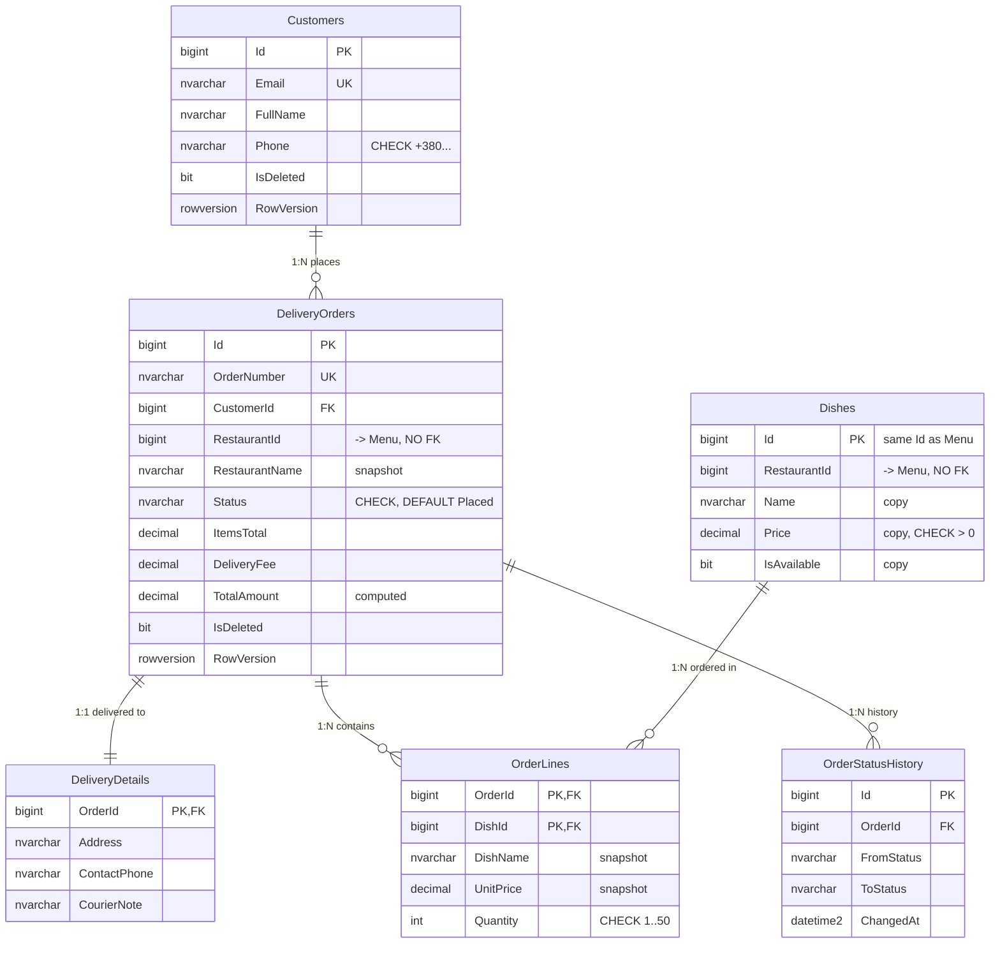
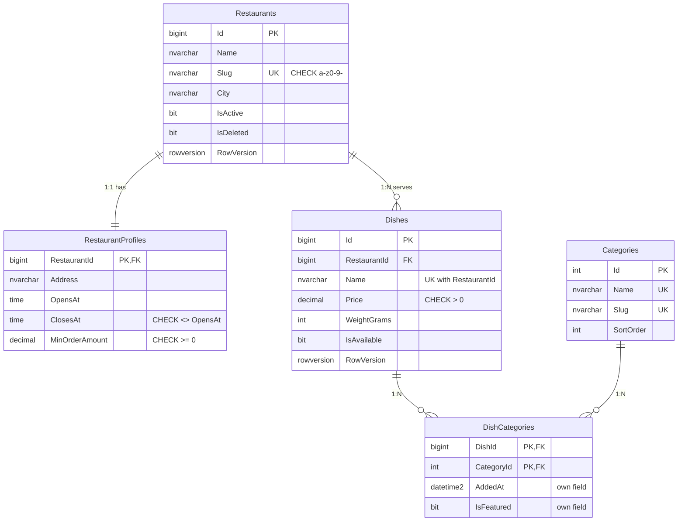
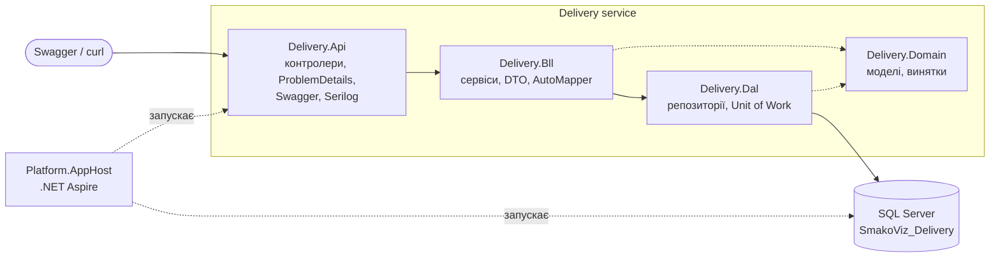
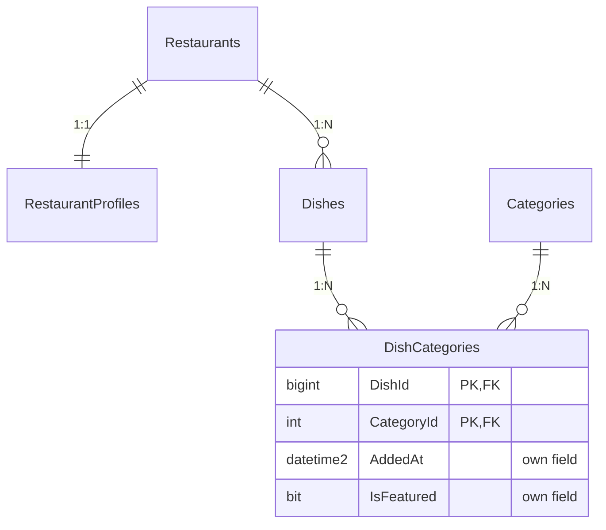
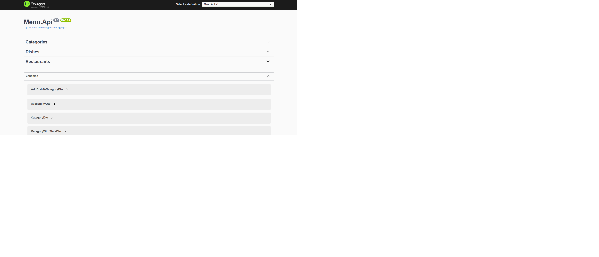
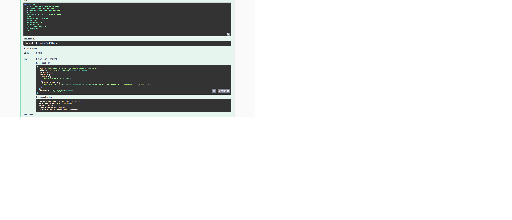
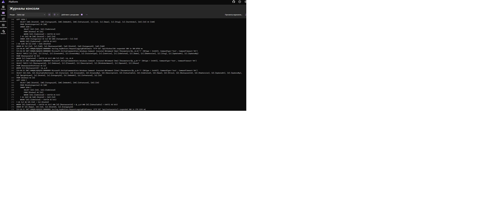

# SmakoViz — сервіс доставки їжі (мікросервісна платформа)

Наскрізний проєкт курсу «Технології .NET у сучасній веб-інженерії».
| Лаба | Що зроблено | Розділ |
|------|-------------|--------|
| Лаб. 01 | Проєктування 3 баз: SQL (Доставка, Меню) + MongoDB (Відгуки) | [розділи 1–8](#1-предметна-область) |
| Лаб. 02 | Мікросервіс «Доставка»: DAL (ADO.NET + Dapper, Unit of Work) → BLL → Web API, запуск через .NET Aspire | [розділ 9](#9-лаб-02--мікросервіс-доставка-dal--bll--api--aspire) |
| Лаб. 03 | Мікросервіс «Меню» на EF Core: Code-First, Fluent API, міграції, Eager/Explicit/M:N, специфікації, пагінація, FluentValidation, Serilog | [розділ 10](#10-лаб-03--мікросервіс-меню-на-ef-core) |

## 1. Предметна область

**SmakoViz** — міський сервіс доставки їжі з ресторанів Чернівців.
Клієнт обирає ресторан і страви, оформлює замовлення з адресою доставки, оплачує його,
ресторан готує, кур'єр привозить. Після доставки клієнт залишає відгуки про страви,
ресторан і кур'єра та спілкується з рестораном в обговореннях.
Мета системи — швидке оформлення замовлення, прозорий статус доставки і чесні оцінки ресторанів.

## 2. Три незалежні контексти (Bounded Contexts)

Кожен контекст = окремий мікросервіс = **власна база даних**. Між базами немає ні спільних таблиць,
ні `FOREIGN KEY`, ні JOIN-ів — лише посилання за ідентифікатором.

| # | Контекст | БД / технологія | Власні сутності (належать **тільки** йому) | Чому така технологія |
|---|----------|-----------------|---------------------------------------------|----------------------|
| 1 | **Доставка** (DeliveryOrders) | `SmakoViz_Delivery` · SQL Server · ADO.NET + Dapper | Customer, DeliveryOrder, DeliveryDetails, OrderLine, OrderStatusHistory (+ локальна копія Dish) | Замовлення — транзакційний процес зі строгими статусами: потрібні транзакції, збережувані процедури, перевірка цілісності |
| 2 | **Меню** (Menu) | `SmakoViz_Menu` · SQL Server · EF Core Code First | Restaurant, RestaurantProfile, Dish, Category, DishCategory | Багато пов'язаних сутностей і всі типи зв'язків — зручно для Fluent API, міграцій і seed-даних |
| 3 | **Відгуки** (Feedback) | `smakoviz_feedback` · MongoDB | Review, Discussion, Message, RatingSummary | Відгуки різних типів мають різну структуру, вкладені коментарі, довгі обговорення — природно лягають у документи |

Детальніше — агрегати, межі й життєвий цикл: [`docs/contexts.md`](docs/contexts.md).

**Хто чим володіє (одне джерело правди):**
- клієнт (ім'я, email) — Доставка;
- ресторан, страва, ціна, категорія — Меню;
- відгук, оцінка, обговорення — Відгуки.

Якщо дані потрібні іншому контексту, він зберігає **лише Id** і, за потреби, **знімок або копію** окремих полів (таблиця нижче).

## 3. Таблиця політики дублювання даних

Два види дублювання:
- **знімок** — фіксується в момент події і **ніколи не оновлюється** (ціна в чеку);
- **копія для читання** — оновлюється **подіями від власника** (eventual consistency, механізм — Лаб. 08).
Жодне дубльоване поле **не редагується** в контексті-копії (немає dual write).

| Поле | Де зберігається | Джерело (власник) | Політика узгодженості |
|------|-----------------|-------------------|-----------------------|
| `OrderLines.DishName`, `OrderLines.UnitPrice` | `SmakoViz_Delivery` (db/p1) | `Dishes` у `SmakoViz_Menu` | **знімок** на момент додавання в замовлення — не оновлюється |
| `DeliveryOrders.RestaurantName` | `SmakoViz_Delivery` (db/p1) | `Restaurants` у `SmakoViz_Menu` | **знімок** на момент оформлення — не оновлюється |
| `Dishes.Name`, `Price`, `IsAvailable`, `RestaurantId` (локальна копія довідника) | `SmakoViz_Delivery` (db/p1) | `Dishes` у `SmakoViz_Menu` | **копія**, оновлюється подіями `DishChanged` / `DishPriceChanged` з Меню |
| `reviews.restaurantName`, `discussions.restaurantName` | MongoDB `smakoviz_feedback` (db/p3) | `Restaurants` у `SmakoViz_Menu` | **копія**, оновлюється подією `RestaurantRenamed` з Меню |
| `reviews.dishName` | MongoDB `smakoviz_feedback` (db/p3) | `Dishes` у `SmakoViz_Menu` | **копія**, оновлюється подією `DishChanged` з Меню |
| `reviews.author.displayName`, `messages.author.displayName` | MongoDB `smakoviz_feedback` (db/p3) | `Customers` у `SmakoViz_Delivery` | **копія**, оновлюється подією `CustomerRenamed` з Доставки |
| `reviews.orderNumber` (+ `orderId`) | MongoDB `smakoviz_feedback` (db/p3) | `DeliveryOrders` у `SmakoViz_Delivery` | **знімок** — номер замовлення не змінюється |
| `ratingSummaries.*` (середні оцінки) | MongoDB `smakoviz_feedback` (db/p3) | `reviews` у тій самій БД | read-model, перераховується aggregation pipeline (`$merge`) |

Пари сервісів, що взаємодіють: **Доставка ↔ Меню**, **Відгуки ↔ Меню**, **Відгуки ↔ Доставка** — для кожної є щонайменше один рядок.

Посилання між базами — **звичайні стовпці/поля без FOREIGN KEY**:
`DeliveryOrders.RestaurantId`, `Dishes.Id` (у db/p1), `reviews.restaurantId`, `reviews.dishId`, `reviews.orderId`, `reviews.author.customerId` (у db/p3).
Цілісність таких посилань за потреби перевіряє код застосунку.

## 4. ERD

### Проєкт №1 — `SmakoViz_Delivery`



**M:N** `DeliveryOrders ↔ Dishes` реалізовано проміжною таблицею `OrderLines` з двома FK (складений PK).

### Проєкт №2 — `SmakoViz_Menu`



**M:N** `Dishes ↔ Categories` — через проміжну **сутність** `DishCategories` з власними полями `AddedAt` і `IsFeatured`.

### Проєкт №3 — MongoDB `smakoviz_feedback`

| Колекція | Прийом | Що всередині |
|----------|--------|--------------|
| `reviews` | **embedding** + **referencing** + гнучка схема | вбудовані `author{}` і `comments[]`; посилання `discussionId`, `orderId`, `restaurantId`, `dishId`; 3 типи відгуків з різними полями (`photos`, `aspects{}`, `courier{}`, `tags[]`) |
| `discussions` | **гібрид** | вбудовані 3 останні повідомлення `recentMessages[]` + лічильник; повна історія — у `messages` |
| `messages` | **referencing** | `discussionId` → `discussions._id` (повідомлень може бути тисячі) |
| `ratingSummaries` | денормалізований read-model | середні оцінки ресторанів, будується `aggregate(... $merge)` |

Приклади документів: [`docs/mongo-documents.md`](docs/mongo-documents.md). ERD також у [`docs/erd.md`](docs/erd.md).

## 5. Структура репозиторію

```
Platform.slnx        одне рішення на всю платформу                            (Лаб. 02+)
Directory.Build.props  спільні налаштування проєктів (.NET 9)
Platform.AppHost/    .NET Aspire — запуск API + SQL Server однією командою    (Лаб. 02)
Services/
  Delivery/          мікросервіс «Доставка» = Проєкт №1 (ADO.NET + Dapper)     (Лаб. 02)
    Delivery.Api/      контролери, Program.cs, appsettings.json, Swagger, Serilog
    Delivery.Bll/      сервіси, DTO, профілі AutoMapper, валідація
    Delivery.Dal/      інтерфейси й реалізації репозиторіїв, Unit of Work
    Delivery.Domain/   моделі, доменні винятки
  Menu/              мікросервіс «Меню» = Проєкт №2 (EF Core)                  (Лаб. 03)
    Menu.Api/          контролери, Program.cs, appsettings.json, Dockerfile
    Menu.Bll/          сервіси, DTO, специфікації, валідатори, мапінг
    Menu.Dal/          DbContext, Configurations/, Migrations/, репозиторії, Seeding/
    Menu.Domain/       сутності з бізнес-правилами, доменні винятки
    create-migration.ps1  генерація міграції InitialCreate + SQL-скрипту
README.md            опис домену, контекстів, політика дублювання, ERD, розгортання
docs/
  contexts.md          контексти, агрегати, життєвий цикл замовлення
  duplication-policy.md  таблиця політики дублювання з поясненнями
  erd.md               ERD обох SQL-баз + схема MongoDB
  mongo-documents.md   приклади документів кожної колекції
db/
  docker-compose.yml   SQL Server 2022 + MongoDB 7
  deploy.ps1 / deploy.sh  розгортання всіх 3 баз однією командою
  p1/  schema.sql · procedures.sql · seed.sql · checks.sql   (SmakoViz_Delivery)
  p2/  schema.sql · seed.sql                                 (SmakoViz_Menu)
  p3/  collections.js · seed.js · queries.js                 (MongoDB smakoviz_feedback)
```

## 6. Розгортання з нуля

### Варіант А — однією командою (потрібен лише Docker Desktop)

```powershell
# Windows
powershell -ExecutionPolicy Bypass -File db\deploy.ps1
```
```bash
# Linux / macOS / Git Bash
bash db/deploy.sh
```

Скрипт піднімає контейнери й виконує всі файли в правильному порядку.
Підключення: SQL Server `localhost,1433`, логін `sa`, пароль `SmakoViz_Dev_2026!` (лише для локальної розробки);
MongoDB `mongodb://localhost:27017`.

### Варіант Б — вручну (SSMS / Azure Data Studio + MongoDB Compass / mongosh)

**Порядок важливий** — кожен наступний скрипт спирається на попередній.

| Крок | БД | Що виконати | Результат |
|------|----|-------------|-----------|
| 1 | Проєкт №1 | `db/p1/schema.sql` | створює БД `SmakoViz_Delivery`, 6 таблиць, індекси, view |
| 2 | Проєкт №1 | `db/p1/procedures.sql` | 6 збережуваних процедур |
| 3 | Проєкт №1 | `db/p1/seed.sql` | 3 клієнти, 10 страв (копія), 4 замовлення в різних статусах |
| 4 | Проєкт №2 | `db/p2/schema.sql` | створює БД `SmakoViz_Menu`, 5 таблиць, індекси |
| 5 | Проєкт №2 | `db/p2/seed.sql` | 7 категорій, 3 ресторани з профілями, 10 страв, зв'язки страва-категорія |
| 6 | Проєкт №3 | `mongosh db/p3/collections.js` | БД `smakoviz_feedback`, 4 колекції з валідаторами, індекси |
| 7 | Проєкт №3 | `mongosh db/p3/seed.js` | 6 відгуків, 2 обговорення, 6 повідомлень, рейтинги |
| 8 | — | переглянути таблицю політики дублювання (розділ 3) | |

> Якщо запускаєте через `sqlcmd`, додайте ключі `-I -f 65001` (QUOTED_IDENTIFIER ON і UTF-8 для кирилиці).

**Усі скрипти ідемпотентні:** схеми перевіряють `IF OBJECT_ID(...) IS NULL`, процедури — `CREATE OR ALTER`,
seed — `IF NOT EXISTS` / `MERGE` / Mongo `upsert` з `$setOnInsert`. Повторний запуск **не створює дублікатів**.

### Перевірка після розгортання

```bash
# SQL: FK, індекси, CRUD, пагінація, недопустимий перехід статусу, конкурентність
docker exec smakoviz-sql /opt/mssql-tools18/bin/sqlcmd -C -I -f 65001 -S localhost -U sa -P "SmakoViz_Dev_2026!" -i /db/p1/checks.sql
# MongoDB: різні набори полів, embedding/referencing/гібрид, агрегації, валідатор
docker exec smakoviz-mongo mongosh --quiet /db/p3/queries.js
```

Що має бути:
- `SELECT * FROM sys.foreign_keys` у кожній SQL-базі показує FK **лише на таблиці цієї ж бази**;
- спроба перевести замовлення `SV-000004` (`Placed`) одразу в `OnTheWay` → **керована помилка 50002**, статус не змінюється;
- `db.reviews.find()` повертає документи з **різними наборами полів**;
- повторний запуск seed-скриптів не змінює кількість записів.

## 7. Збережувані процедури Проєкту №1

| Процедура | Призначення | Помилки |
|-----------|-------------|---------|
| `usp_Customer_Upsert` | створити/оновити клієнта за email | — |
| `usp_Order_Create` | замовлення + деталі доставки + запис історії (одна транзакція) | 50001 |
| `usp_Order_AddLine` | додати страву, записати **знімок** назви й ціни, перерахувати суму | 50001, 50004 |
| `usp_Order_GetById` | шапка, позиції, історія — 3 набори результатів | 50001 |
| `usp_Order_ChangeStatus` | **транзакційна зміна статусу** з перевіркою переходу, `UPDLOCK`, `RowVersion` | 50001, 50002, 50003, 50004 |
| `usp_Order_SoftDelete` | м'яке видалення лише завершених замовлень | 50001, 50004 |

Життєвий цикл (за зразком `OrderStatus` з eShop):
`Placed → Confirmed → Paid → Cooking → OnTheWay → Delivered`; `Cancelled` — лише з `Placed` або `Confirmed` (до оплати).
Відправити кур'єром неоплачене замовлення неможливо: процедура кидає `THROW 50002`.

## 8. Ключові рішення

- **PK `BIGINT IDENTITY`** — записи створює один сервіс, ключ компактний і послідовний (кластерний індекс не фрагментується, як з випадковим GUID). GUID доречний, якщо Id генерують у різних місцях (у MongoDB для цього є `ObjectId`). Локальна копія `Dishes` у p1 бере Id з Меню, тому без `IDENTITY`.
- **Каскади усвідомлені:** `ON DELETE CASCADE` — для деталей, позицій та історії замовлення (не існують без нього); **без каскаду** — `Customers → DeliveryOrders` (клієнта з історією видаляти не можна), `Restaurants → Dishes`.
- **Аудит і м'яке видалення:** `CreatedAt/CreatedBy/UpdatedAt/UpdatedBy/IsDeleted` у `Customers`, `DeliveryOrders`, `Restaurants`, `Dishes`; фільтровані індекси `WHERE IsDeleted = 0` працюють лише з «живими» рядками.
- **Оптимістична конкурентність:** `ROWVERSION` там, де можливий паралельний запис (статус замовлення змінюють ресторан, кур'єр і клієнт; ціну страви — менеджер і адмін). Якщо версія змінилась — `usp_Order_ChangeStatus` повертає 50003 замість «тихого» перезапису.
- **Кожен індекс — під конкретний запит**, пояснення стоїть коментарем над `CREATE INDEX` у `schema.sql`.

---

## 9. Лаб. 02 — мікросервіс «Доставка» (DAL → BLL → API + Aspire)

Сервіс **Delivery** — самостійна вертикаль (vertical slice) поверх бази Проєкту №1 (`SmakoViz_Delivery`):
від таблиць і процедур Лаб. 01 до REST API.

### 9.1. Що потрібно для запуску

| Інструмент | Навіщо |
|------------|--------|
| [.NET 9 SDK](https://dotnet.microsoft.com/download/dotnet/9.0) (або Visual Studio 2022 17.14+) | збірка й запуск (`dotnet --version` → 9.0.x) |
| Docker Desktop (запущений) | SQL Server у контейнері для Aspire |

### 9.2. Запуск однією командою через .NET Aspire

```bash
dotnet run --project Platform.AppHost
```

1. У консолі з'явиться посилання на **Aspire Dashboard** (`https://localhost:17180/login?t=...`) — відкрий його.
2. Aspire підніме контейнер **sql** (SQL Server), створить БД `SmakoViz_Delivery`, а API при старті застосує
   `db/p1/schema.sql → procedures.sql → seed.sql` (ідемпотентно; змінна `Database__Initialize=true`).
3. Коли `sql`, `DeliveryDb` і `delivery-api` мають статус **Running**, натисни на адресу `delivery-api`
   і допиши `/swagger`.

Перший запуск довгий (завантаження образу SQL Server ~1,5 ГБ). Дані зберігаються у volume `smakoviz-delivery-sql`.

У Visual Studio: відкрий `Platform.slnx` → правою кнопкою на `Platform.AppHost` → **Set as Startup Project** → F5.

### 9.3. Запуск без Aspire (на базі з Лаб. 01)

```bash
powershell -ExecutionPolicy Bypass -File db\deploy.ps1     # SQL Server у Docker на localhost,1433 + дані
dotnet run --project Services/Delivery/Delivery.Api       # http://localhost:5080/swagger
```

Рядок підключення — `Services/Delivery/Delivery.Api/appsettings.json` → `ConnectionStrings:DeliveryDb`.
Перевизначається змінною оточення (подвійне підкреслення замість двокрапки):

```powershell
$env:ConnectionStrings__DeliveryDb = "Server=...;Database=SmakoViz_Delivery;..."
```

### 9.4. Схема рішення



Залежності лише в один бік: **Api → Bll → Dal**, `Domain` підключають і Dal, і Bll.
Посилання Api → Dal потрібне тільки `Program.cs` (composition root), щоб зареєструвати `UnitOfWork` у DI;
контролери працюють лише з сервісами BLL і ніколи не бачать репозиторіїв. Увесь SQL — тільки в `Delivery.Dal`.

**DI** (`Program.cs`): `IUnitOfWork` — **Scoped** (одне з'єднання на HTTP-запит), сервіси BLL — **Scoped**,
AutoMapper з профілем `DeliveryProfile`, логування — **Serilog**. Рядок підключення — `appsettings.json` →
`ConnectionStrings:DeliveryDb`.

| Шар | Що всередині |
|-----|--------------|
| `Delivery.Domain` | `Customer`, `Dish`, `DeliveryOrder` (+ `DeliveryDetails`, `OrderLine`, `OrderStatusChange`), `OrderStatus`, `PagedResult<T>`; винятки `NotFoundException`, `BusinessConflictException`, `ConcurrencyConflictException`, `BusinessRuleException`, `ValidationException` |
| `Delivery.Dal` | `IGenericRepository<T>` → `BaseDapperRepository<T>` (спільний CRUD один раз); **`CustomerRepository` — чистий ADO.NET** (свідомо без Generic Repository); **`DishRepository`, `OrderRepository` — ADO.NET + Dapper** (multi-mapping, `QueryMultiple`, процедури Лаб. 01); `UnitOfWork`; `SqlErrorTranslator`; `DatabaseInitializer` |
| `Delivery.Bll` | `CustomerService`, `DishService`, `OrderService`; DTO (records + DataAnnotations); профіль `DeliveryProfile` (AutoMapper) |
| `Delivery.Api` | `CustomersController`, `DishesController`, `OrdersController` (attribute routing, async, `CancellationToken`); `DomainExceptionHandler` (ProblemDetails); `CorrelationIdMiddleware`; Swagger; Serilog |
| `Platform.AppHost` | Aspire: `sql` (SQL Server + volume) → база `DeliveryDb` → `delivery-api` |

### 9.5. Транзакційна операція: оформлення замовлення

`POST /api/orders` → `OrderService.PlaceOrderAsync` — **одна транзакція на три репозиторії**:

```
BEGIN TRAN (READ COMMITTED)
  1. Customers.ExistsAsync          ADO.NET   клієнт існує?                    → інакше 400
  2. Dishes.GetByIdsAsync           Dapper    ціни з копії Меню, один ресторан  → інакше 400 / 422
  3. Orders.AddAsync                Dapper    usp_Order_Create: шапка + деталі + історія
  4. Orders.AddLineAsync × N        Dapper    usp_Order_AddLine: ЗНІМОК назви й ціни, перерахунок суми
COMMIT   — або ROLLBACK, якщо будь-який крок впав
```

Вартість доставки рахує BLL: 0 ₴ від 500 ₴, інакше 40 ₴.

**Перевірка відкату:** замов страву `303` («Місо-суп», у seed `IsAvailable = 0`) разом із `301`.
Позиція 301 і саме замовлення вже записані, але `usp_Order_AddLine` для 303 кидає `THROW 50004` →
`BusinessRuleException` → **422**, і `ROLLBACK` прибирає все: у `GET /api/orders` нового замовлення немає.

Як Unit of Work тримає все в одній транзакції: репозиторії створюються всередині `UnitOfWork` і отримують
**те саме** `SqlConnection` та функцію `() => _transaction`, тому кожна команда автоматично йде в поточну транзакцію.

**Рівень ізоляції — READ COMMITTED, таймаут команди — 30 с.** Компроміс *deadlocks vs consistency*:
SERIALIZABLE прибрав би більше аномалій читання, але тримав би діапазонні блокування й частіше ловив deadlock.
Нам вистачає READ COMMITTED, бо критичний рядок (замовлення) процедури блокують точково (`UPDLOCK`),
а паралельні зміни ловить `ROWVERSION` (оптимістична конкурентність → 409).

### 9.6. Від процедури до HTTP-статусу

| Звідки | DAL (`SqlErrorTranslator`) | BLL / API | HTTP |
|--------|----------------------------|-----------|------|
| `THROW 50001` (не знайдено) | `NotFoundException` | | **404** |
| `THROW 50002` (недопустимий перехід статусу) | `BusinessConflictException` | | **409** |
| `THROW 50003` (RowVersion змінився) | `ConcurrencyConflictException` | | **409** |
| `THROW 50004` (бізнес-правило) | `BusinessRuleException` | | **422** |
| SQL 2601 / 2627 (UNIQUE) | `BusinessConflictException` | | **409** |
| DataAnnotations на DTO | | `[ApiController]` | **400** |
| бізнес-валідація (клієнт не існує, кривий RowVersion) | | `ValidationException` | **400** |
| будь-що інше | | без деталей | **500** |

Перетворення робить **один** глобальний `DomainExceptionHandler` (`IExceptionHandler`), а не try/catch у кожному
контролері. Відповідь завжди у форматі **ProblemDetails** (RFC 9457) з `traceId`.

### 9.7. Ендпоінти

| Метод | Шлях | Успіх | Помилки |
|-------|------|-------|---------|
| GET | `/api/customers?q=&page=&pageSize=` | 200 | 400 |
| GET | `/api/customers/{id}` | 200 | 404 |
| POST | `/api/customers` | 201 + Location | 400, 409 |
| PUT | `/api/customers/{id}` (з `rowVersion`) | 200 | 400, 404, 409 |
| DELETE | `/api/customers/{id}` | 204 | 404 |
| GET | `/api/dishes?restaurantId=&onlyAvailable=` | 200 | 400 |
| GET | `/api/dishes/{id}` | 200 | 404 |
| PUT | `/api/dishes/{id}` (синхронізація копії з Меню) | 200 | 400 |
| GET | `/api/orders?customerId=&status=&page=&pageSize=` | 200 | 400 |
| GET | `/api/orders/{id}` | 200 | 404 |
| POST | `/api/orders` (заголовок `Idempotency-Key` — необов'язковий) | 201 + Location / 200 для повтору | 400, 422 |
| POST | `/api/orders/{id}/lines` | 200 | 400, 404, 422 |
| POST | `/api/orders/{id}/confirm` | 204 | 404, 409, 422 |
| POST | `/api/orders/{id}/cancel` | 204 | 404, 409 |
| POST | `/api/orders/{id}/status` | 204 | 400, 404, 409 |
| DELETE | `/api/orders/{id}` (лише Delivered/Cancelled) | 204 | 404, 422 |

Повний опис DTO і статусів — у **Swagger** (`/swagger`). Готові запити — у `Services/Delivery/Delivery.Api/Delivery.Api.http`.

### 9.8. Приклади перевірки (curl)

Підстав адресу API з Aspire Dashboard (або `http://localhost:5080` без Aspire):

```bash
API=http://localhost:5080

# 200 — замовлення з seed Лаб. 01 (SV-000001) з позиціями та історією статусів
curl $API/api/orders/1

# 404 ProblemDetails, а не 500
curl -i $API/api/orders/999999

# 201 + Location — оформлення замовлення (транзакція)
curl -i -X POST $API/api/orders -H "Content-Type: application/json" -H "Idempotency-Key: demo-001" \
  -d '{"customerId":2,"restaurantName":"Буковинська хата","address":"м. Чернівці, вул. Руська, 5","contactPhone":"+380672223344","items":[{"dishId":101,"quantity":1},{"dishId":102,"quantity":2}]}'

# той самий Idempotency-Key ще раз → 200 і те саме замовлення (друге не створюється)

# 422 + ВІДКАТ — страва 303 недоступна; замовлення не з'являється
curl -i -X POST $API/api/orders -H "Content-Type: application/json" \
  -d '{"customerId":3,"restaurantName":"Суші Дзен","address":"м. Чернівці, просп. Незалежності, 101","contactPhone":"+380935554466","items":[{"dishId":301,"quantity":1},{"dishId":303,"quantity":1}]}'

# 204, потім 409 — підтвердження SV-000004 і повторне підтвердження
curl -i -X POST $API/api/orders/4/confirm
curl -i -X POST $API/api/orders/4/confirm

# 409 — недопустимий перехід: доставлене замовлення не можна знову відправити кур'єром
curl -i -X POST $API/api/orders/1/status -H "Content-Type: application/json" -d '{"status":"OnTheWay"}'

# 201 — ім'я з апострофом: параметри, а не конкатенація, тож SQL не ламається
curl -i -X POST $API/api/customers -H "Content-Type: application/json" \
  -d '{"email":"sean.obrien@example.com","fullName":"Sean O'"'"'Brien","phone":"+380991234567"}'

# 400 ValidationProblemDetails — невалідний email і порожнє ім'я
curl -i -X POST $API/api/customers -H "Content-Type: application/json" -d '{"email":"bad","fullName":""}'
```

### 9.9. Безпека запитів і з'єднань

- **Жодної конкатенації значень у SQL**: ADO.NET — `command.Parameters.Add("@Id", SqlDbType.BigInt)`, Dapper — анонімні
  об'єкти / `DynamicParameters`, списки — `WHERE Id IN @Ids`. Ім'я таблиці в `BaseDapperRepository<T>` — константа з коду.
- `LIKE`-пошук екранує `%`, `_`, `[`.
- З'єднання, команди й рідери звільняються через `await using`; пул підключень SqlClient увімкнений за замовчуванням.
- «Сирі» SQL-повідомлення не потрапляють у відповідь: `SqlErrorTranslator` → доменні винятки → ProblemDetails.
- Логи (Serilog) мають `CorrelationId` (заголовок `X-Correlation-Id`) і не містять паролів чи рядків підключення.

### 9.10. Знімки екрана

| Swagger | Aspire Dashboard |
|---------|------------------|
|  |  |

---

## 10. Лаб. 03 — мікросервіс «Меню» на EF Core

Сервіс **Menu** — Проєкт №2 з Лаб. 01 (`SmakoViz_Menu`), побудований **Code-First**: схему бази створюють
міграції EF Core з моделей і конфігурацій Fluent API. Будова шарів — та сама, що в Лаб. 02.

### 10.1. Запуск

**Крок 1 — один раз: згенерувати міграцію** (база для цього не потрібна):

```powershell
powershell -ExecutionPolicy Bypass -File Services\Menu\create-migration.ps1
```

Скрипт ставить `dotnet-ef`, створює `Services/Menu/Menu.Dal/Migrations/*_InitialCreate.cs` + `MenuDbContextModelSnapshot.cs`
і SQL-скрипт `Migrations/InitialCreate.sql`. Деталі — у [`Menu.Dal/Migrations/README.md`](Services/Menu/Menu.Dal/Migrations/README.md).

**Крок 2 — запуск усієї платформи через Aspire** (Docker Desktop має бути запущений):

```bash
dotnet run --project Platform.AppHost
```

У Dashboard з'являться `sql`, `DeliveryDb`, `MenuDb`, `delivery-api`, `menu-api`. При старті `menu-api`:

1. `MigrateAsync()` застосовує міграції (таблиці, індекси, CHECK, довідник категорій з `HasData`);
2. `DbInitializer.SeedAsync()` додає 3 ресторани з профілями й 10 страв — **лише якщо їх ще немає**
   (повторний запуск дублів не створює; у Production сідінг вимкнено, а ще його вимикає `Database:Seed=false`).

Відкрий адресу `menu-api` з Dashboard і допиши `/swagger`.

Без Aspire (на SQL Server з Лаб. 01, `db/deploy.ps1`): `dotnet run --project Services/Menu/Menu.Api` →
`http://localhost:5090/swagger` (база `SmakoViz_Menu_Ef` створиться міграцією).

Docker-образ API: `docker build -f Services/Menu/Menu.Api/Dockerfile -t smakoviz/menu-api .` (з кореня репозиторію).

### 10.2. Модель (Code-First + Fluent API)



| Сутність | Бізнес-правила в самій сутності (приватні setter-и, зміни лише методами) |
|----------|---------------------------------------------------------------------------|
| `Dish` | ціна в конструкторі й `ChangePrice()` — завжди > 0; порції — лише `AddPortions()` / `RemovePortions()` (аналог `AddStock`/`RemoveStock` з eShop, у мінус не можна); категорії — `AddToCategory()` / `RemoveFromCategory()` (дубль заборонено) |
| `Restaurant` | slug — лише `a-z0-9-`; профіль 1:1 — `SetProfile()`; `Activate()` / `Deactivate()` |
| `RestaurantProfile` | години відкриття й закриття різні, мінімальна сума ≥ 0 |
| `Category` | довідник; засівається `HasData` з фіксованими Id |
| `DishCategory` | **явна проміжна сутність M:N**: складений ключ `(DishId, CategoryId)` + власні поля `AddedAt`, `IsFeatured` |

Кожна сутність має свій `IEntityTypeConfiguration<T>` у `Menu.Dal/Configurations/` (таблиця, ключі, довжини,
`decimal(18,2)`, унікальні індекси, CHECK-обмеження, зв'язки), підключення — одним рядком
`modelBuilder.ApplyConfigurationsFromAssembly(...)` в `OnModelCreating`.
Аудит (`CreatedAt/By`, `UpdatedAt/By`), м'яке видалення (`IsDeleted` + глобальний фільтр) і `RowVersion` — у
`AuditableEntity`; значення проставляє `MenuDbContext.SaveChangesAsync`.

### 10.3. Репозиторії та Unit of Work

| Репозиторій | Прийом | Метод | SQL-запитів у лозі |
|-------------|--------|-------|--------------------|
| `GenericRepository<T>` | Async Generic Repository на `DbSet<T>` | `GetByIdAsync`, `GetAllAsync`, `AddAsync`, `Update`, `Delete`, `ListAsync(spec)`, `CountAsync(spec)` | — |
| `DishRepository` | **Eager Loading** | `GetWithDetailsAsync` — `Include(Restaurant).ThenInclude(Profile)` + `Include(DishCategories).ThenInclude(Category)` | **1** |
| `RestaurantRepository` | **Explicit Loading** | `GetWithMenuAsync` — ресторан, потім `Entry().Reference(Profile).LoadAsync()`, потім `Entry().Collection(Dishes).Query()...LoadAsync()` | **3** (окремі) |
| `DishCategoryRepository` | **LINQ to Entities через проміжну сутність M:N** | `GetRecentlyAddedAsync` (за `AddedAt`), `GetFeaturedAsync` (за `IsFeatured`), `CountAvailableDishesByCategoryAsync` (GROUP BY) | 1 |

`Update` і `Delete` лише змінюють стан у Change Tracker; **репозиторії нічого не зберігають самі** —
`UnitOfWork.SaveChangesAsync()` викликається один раз наприкінці бізнес-операції (усі зміни — однією транзакцією).
Конфлікт `RowVersion` і порушення UNIQUE `UnitOfWork` перетворює на `ConflictException` (409).

### 10.4. Пагінація, фільтрація, сортування (у SQL)

`GET /api/dishes?search=Піца&minPrice=100&maxPrice=300&categoryId=3&onlyAvailable=true&sortBy=price&sortDir=desc&page=1&pageSize=5`

- `page` — з 1; `pageSize` — за замовчуванням 20, максимум 100 (більше обрізається);
- фільтри: `search`, `restaurantId`, `categoryId` (через M:N), `minPrice`, `maxPrice`, `onlyAvailable`;
- сортування лише за дозволеними полями: `name | price | calories | createdAt`, `sortDir=asc|desc`
  (інше → 400 від `DishQueryValidator`);
- фільтри, `ORDER BY` і `Skip/Take` описані в **специфікації** `DishesFilterSpec` і виконуються **до** `ToListAsync()`:
  база повертає лише потрібну сторінку (`OFFSET ... FETCH`), а `totalCount` рахує окремий `SELECT COUNT(*)`.

Відповідь — у тілі **і** в заголовках (`X-Total-Count`, `X-Total-Pages`, `X-Page`, `X-Page-Size`):

```json
{
  "items": [ { "id": 202, "restaurantName": "Pizza Pronto", "name": "Піца Чотири сири 30 см", "price": 265.00, "...": "..." } ],
  "totalCount": 10, "page": 2, "pageSize": 5, "totalPages": 2, "hasNext": false, "hasPrevious": true
}
```

Ресторани: `GET /api/restaurants?city=Чернівці&cuisineType=Італійська&sortBy=name&page=1&pageSize=10`
(друга специфікація `RestaurantsFilterSpec` працює через той самий `ListAsync(spec)` без змін у репозиторії).

### 10.5. Валідація, помилки, логування

- **DataAnnotations** на DTO — прості правила (`Required`, `StringLength`, `Range`): некоректний запит
  відхиляється з 400 ще до сервісу. **FluentValidation** (`Menu.Bll/Validation`) — складні правила:
  формат slug і телефону, години роботи, ціна з ≤ 2 знаками після коми, `maxPrice ≥ minPrice`, дозволені поля
  сортування. Валідатори реєструються `AddValidatorsFromAssemblyContaining<>()` і **викликаються явно** в сервісах
  (без застарілого `AddFluentValidation`). Відповідь — `ValidationProblemDetails` з помилками по полях.
- **ProblemDetails** — один глобальний `GlobalExceptionHandler`:
  `EntityNotFoundException → 404`, `ValidationException → 400`, `ConflictException → 409`, `DomainException → 409`,
  інше → 500 (повідомлення внутрішньої помилки — лише в Development). Виняток логується **один раз** — в обробнику
  (вбудований лог `ExceptionHandlerMiddleware` вимкнено в `appsettings.json`).
- **Serilog**: структуровані властивості (`CorrelationId`, `RequestPath`, `UserId`, `Service`, `StatusCode`),
  sink — консоль, `UseSerilogRequestLogging`, SQL-команди EF Core на рівні Information
  (`Microsoft.EntityFrameworkCore.Database.Command`). Рівні — у секції `Serilog` файлу `appsettings.json`,
  перевизначаються змінними оточення, напр. `Serilog__MinimumLevel__Default=Warning`.

### 10.6. Приклади перевірки

```bash
API=http://localhost:5090          # або адреса menu-api з Aspire Dashboard

curl "$API/api/dishes?page=2&pageSize=5"                         # totalCount = 10 (усі), на сторінці 5
curl "$API/api/dishes?search=Піца&sortBy=price&sortDir=desc"      # фільтр + сортування в SQL
curl "$API/api/dishes?sortBy=password"                           # 400: недозволене поле сортування
curl "$API/api/dishes/101"                                       # Eager: у лозі API один SELECT
curl "$API/api/restaurants/1"                                    # Explicit: у лозі три SELECT
curl -i "$API/api/dishes/999999"                                 # 404 ProblemDetails

# 201 + Location, потім те саме ще раз → 409 (назва в ресторані вже зайнята)
curl -i -X POST "$API/api/dishes" -H "Content-Type: application/json" \
  -d '{"restaurantId":1,"name":"Деруни зі сметаною","price":135.5,"initialPortions":25,"categoryIds":[2,6]}'

# 400 з помилками по полях (порожня назва, від'ємна ціна)
curl -i -X POST "$API/api/dishes" -H "Content-Type: application/json" -d '{"restaurantId":1,"name":"","price":-5}'

# 409 — правило сутності: списати порцій більше, ніж є
curl -i -X POST "$API/api/dishes/101/portions/remove" -H "Content-Type: application/json" -d '{"quantity":999}'

# 409 — ресторан зі стравами видаляти не можна
curl -i -X DELETE "$API/api/restaurants/1"

# M:N через проміжну сутність: нові «Хіти продажу» (AddedAt) і рекомендовані піци (IsFeatured)
curl "$API/api/categories/bestseller/recent?days=120"
curl "$API/api/categories/3/featured"

# профіль ресторану: час — у форматі "HH:mm:ss"
curl -i -X PUT "$API/api/restaurants/3/profile" -H "Content-Type: application/json" \
  -d '{"address":"просп. Незалежності, 52","phone":"+380372555003","opensAt":"11:00:00","closesAt":"23:30:00","minOrderAmount":300}'
```

Ще більше запитів — у `Services/Menu/Menu.Api/Menu.Api.http`.

### 10.7. Знімки екрана

| Swagger | Пагінація | 400 з помилками валідації | SQL у лозі (eager / explicit) |
|---------|-----------|---------------------------|-------------------------------|
|  |  |  |  |
