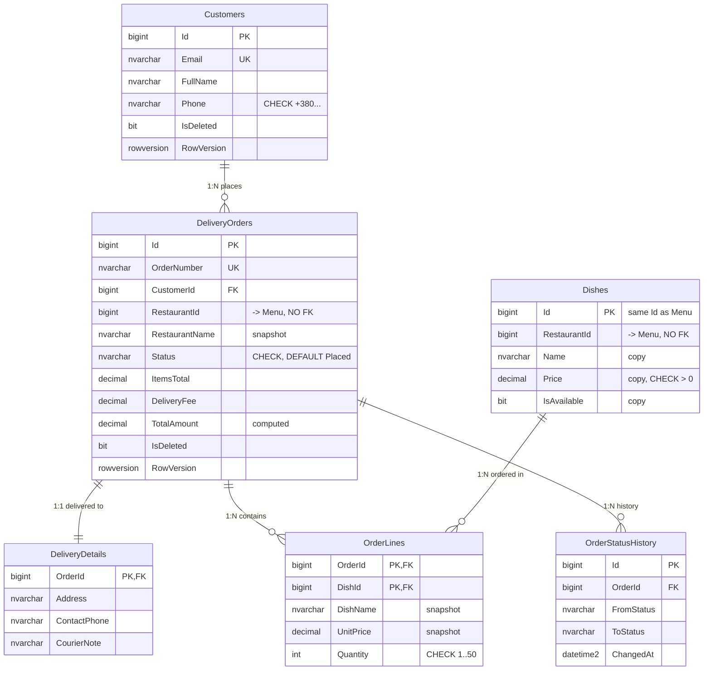
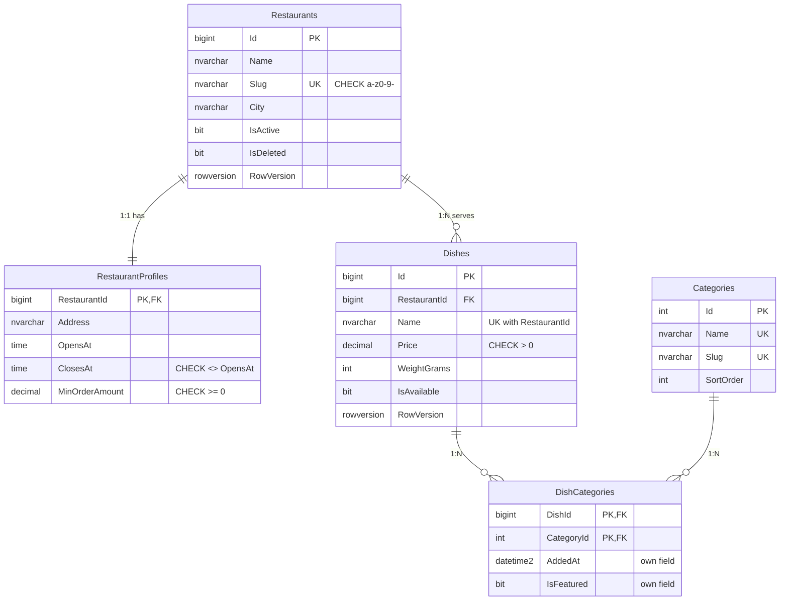
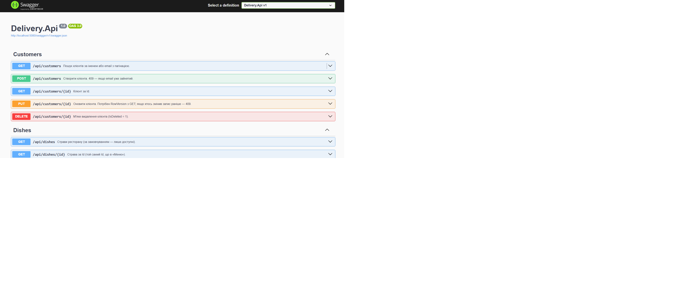
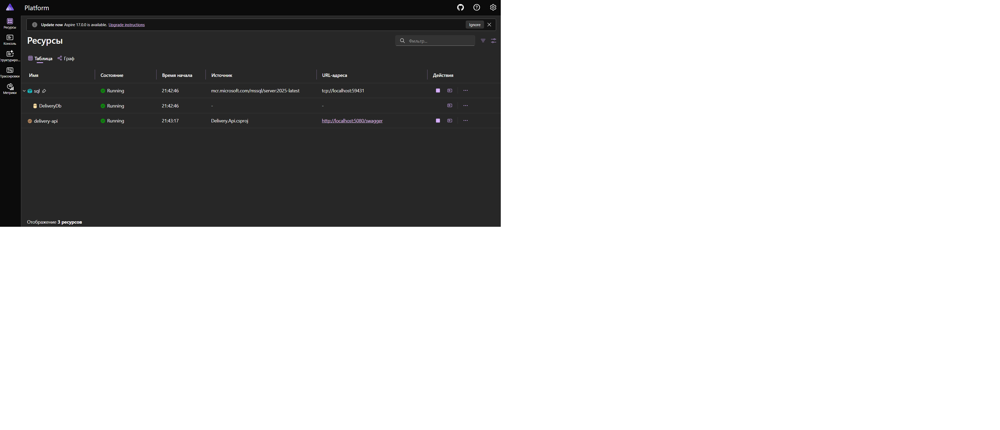
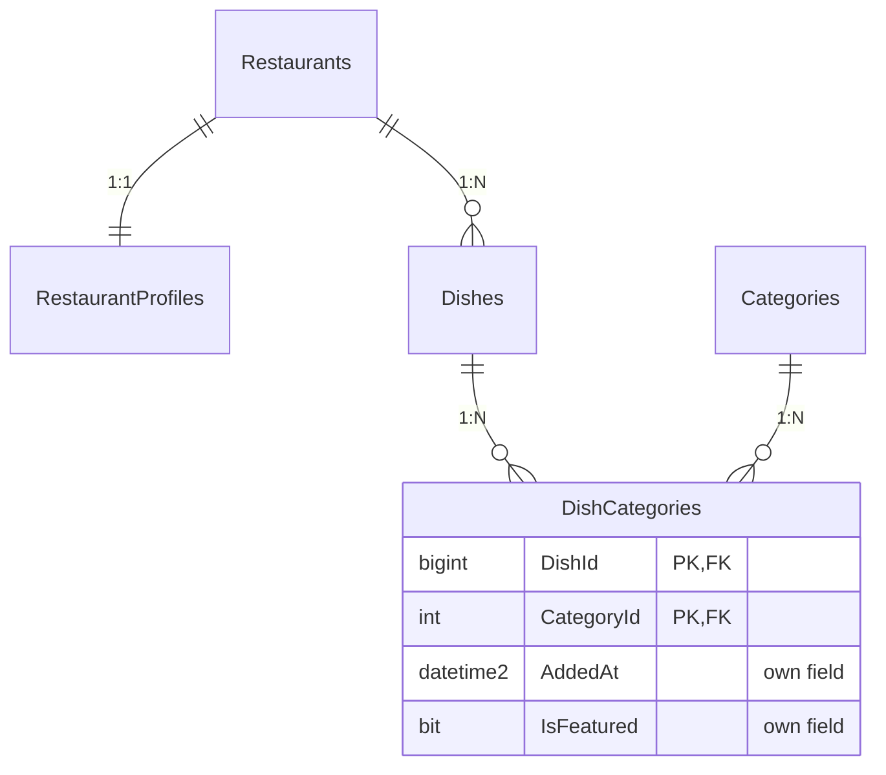
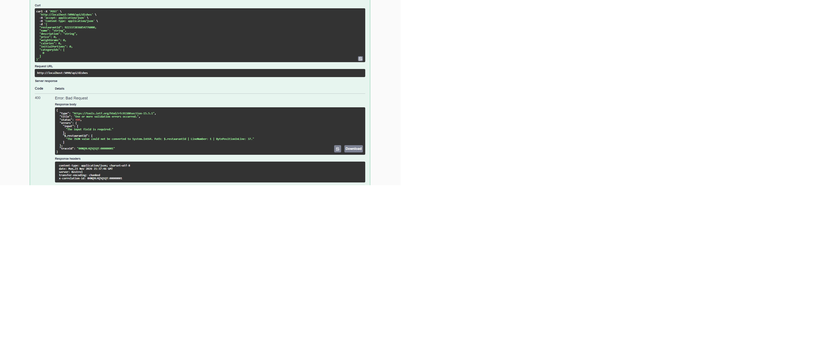
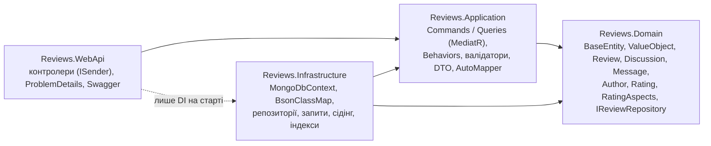
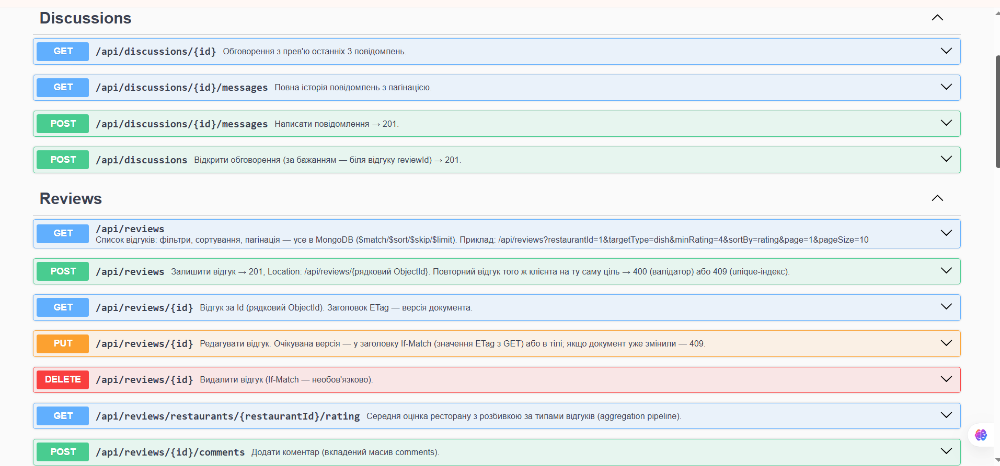
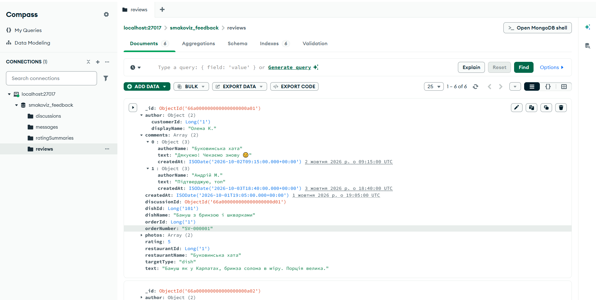
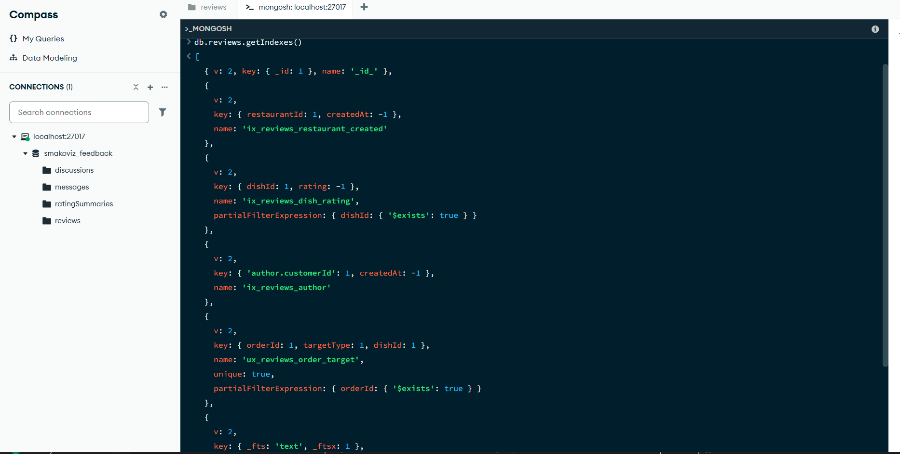

# SmakoViz — сервіс доставки їжі (мікросервісна платформа)

Наскрізний проєкт курсу «Технології .NET у сучасній веб-інженерії».
| Лаба | Що зроблено | Розділ |
|------|-------------|--------|
| Лаб. 01 | Проєктування 3 баз: SQL (Доставка, Меню) + MongoDB (Відгуки) | [розділи 1–8](#1-предметна-область) |
| Лаб. 02 | Мікросервіс «Доставка»: DAL (ADO.NET + Dapper, Unit of Work) → BLL → Web API, запуск через .NET Aspire | [розділ 9](#9-лаб-02--мікросервіс-доставка-dal--bll--api--aspire) |
| Лаб. 03 | Мікросервіс «Меню» на EF Core: Code-First, Fluent API, міграції, Eager/Explicit/M:N, специфікації, пагінація, FluentValidation, Serilog | [розділ 10](#10-лаб-03--мікросервіс-меню-на-ef-core) |
| Лаб. 04 | Мікросервіс «Відгуки»: Clean Architecture (4 шари) + CQRS (MediatR) + MongoDB, Value Objects, pipeline behaviors | [розділ 11](#11-лаб-04--мікросервіс-відгуки-clean-architecture--cqrs--mongodb) |
| Лаб. 05 | Платформа .NET Aspire: ServiceDefaults (Serilog + OpenTelemetry + CorrelationId), API Gateway (YARP), Aggregator (Task.WhenAll, часткові відмови) | [розділ 12](#12-лаб-05--платформа-net-aspire-gateway-aggregator-observability) |
| Лаб. 06 | Кешування L1 (IMemoryCache) + L2 (Redis), gRPC-контракти й сервіси, Aggregator на gRPC, метрики кешу | [розділ 13](#13-лаб-06--grpc-і-кешування-l1--l2) |
| Лаб. 07 | Resilience (retry, circuit breaker, таймаути; критичні vs некритичні), бізнес-метрики, health checks (live / ready) | [розділ 14](#14-лаб-07--resilience-метрики-health-checks) |
| Лаб. 08 | RabbitMQ: integration events, topic exchange + DLX/DLQ, ідемпотентні споживачі, реплікація копій, traceparent через брокер | [розділ 15](#15-лаб-08--інтеграційні-події-через-rabbitmq) |

## 1. Предметна область

**SmakoViz** — міський сервіс доставки їжі з ресторанів Чернівців.
Клієнт обирає ресторан і страви, оформлює замовлення з адресою доставки, оплачує його,
ресторан готує, кур'єр привозить. Після доставки клієнт залишає відгуки про страви,
ресторан і кур'єра та спілкується з рестораном в обговореннях.
Мета системи — швидке оформлення замовлення, прозорий статус доставки і чесні оцінки ресторанів.

## 2. Три незалежні контексти (Bounded Contexts)

Кожен контекст = окремий мікросервіс = **власна база даних**. Між базами немає ні спільних таблиць,
ні `FOREIGN KEY`, ні JOIN-ів — лише посилання за ідентифікатором.

| # | Контекст | БД / технологія | Власні сутності (належать **тільки** йому) | Чому така технологія |
|---|----------|-----------------|---------------------------------------------|----------------------|
| 1 | **Доставка** (DeliveryOrders) | `SmakoViz_Delivery` · SQL Server · ADO.NET + Dapper | Customer, DeliveryOrder, DeliveryDetails, OrderLine, OrderStatusHistory (+ локальна копія Dish) | Замовлення — транзакційний процес зі строгими статусами: потрібні транзакції, збережувані процедури, перевірка цілісності |
| 2 | **Меню** (Menu) | `SmakoViz_Menu` · SQL Server · EF Core Code First | Restaurant, RestaurantProfile, Dish, Category, DishCategory | Багато пов'язаних сутностей і всі типи зв'язків — зручно для Fluent API, міграцій і seed-даних |
| 3 | **Відгуки** (Feedback) | `smakoviz_feedback` · MongoDB | Review, Discussion, Message, RatingSummary | Відгуки різних типів мають різну структуру, вкладені коментарі, довгі обговорення — природно лягають у документи |

Детальніше — агрегати, межі й життєвий цикл: [`docs/contexts.md`](docs/contexts.md).

**Хто чим володіє (одне джерело правди):**
- клієнт (ім'я, email) — Доставка;
- ресторан, страва, ціна, категорія — Меню;
- відгук, оцінка, обговорення — Відгуки.

Якщо дані потрібні іншому контексту, він зберігає **лише Id** і, за потреби, **знімок або копію** окремих полів (таблиця нижче).

## 3. Таблиця політики дублювання даних

Два види дублювання:
- **знімок** — фіксується в момент події і **ніколи не оновлюється** (ціна в чеку);
- **копія для читання** — оновлюється **подіями від власника** (eventual consistency, механізм — Лаб. 08).
Жодне дубльоване поле **не редагується** в контексті-копії (немає dual write).

| Поле | Де зберігається | Джерело (власник) | Політика узгодженості |
|------|-----------------|-------------------|-----------------------|
| `OrderLines.DishName`, `OrderLines.UnitPrice` | `SmakoViz_Delivery` (db/p1) | `Dishes` у `SmakoViz_Menu` | **знімок** на момент додавання в замовлення — не оновлюється |
| `DeliveryOrders.RestaurantName` | `SmakoViz_Delivery` (db/p1) | `Restaurants` у `SmakoViz_Menu` | **знімок** на момент оформлення — не оновлюється |
| `Dishes.Name`, `Price`, `IsAvailable`, `RestaurantId` (локальна копія довідника) | `SmakoViz_Delivery` (db/p1) | `Dishes` у `SmakoViz_Menu` | **копія**, оновлюється подіями `DishChanged` / `DishPriceChanged` з Меню |
| `reviews.restaurantName`, `discussions.restaurantName` | MongoDB `smakoviz_feedback` (db/p3) | `Restaurants` у `SmakoViz_Menu` | **копія**, оновлюється подією `RestaurantRenamed` з Меню |
| `reviews.dishName` | MongoDB `smakoviz_feedback` (db/p3) | `Dishes` у `SmakoViz_Menu` | **копія**, оновлюється подією `DishChanged` з Меню |
| `reviews.author.displayName`, `messages.author.displayName` | MongoDB `smakoviz_feedback` (db/p3) | `Customers` у `SmakoViz_Delivery` | **копія**, оновлюється подією `CustomerRenamed` з Доставки |
| `reviews.orderNumber` (+ `orderId`) | MongoDB `smakoviz_feedback` (db/p3) | `DeliveryOrders` у `SmakoViz_Delivery` | **знімок** — номер замовлення не змінюється |
| `ratingSummaries.*` (середні оцінки) | MongoDB `smakoviz_feedback` (db/p3) | `reviews` у тій самій БД | read-model, перераховується aggregation pipeline (`$merge`) |

Пари сервісів, що взаємодіють: **Доставка ↔ Меню**, **Відгуки ↔ Меню**, **Відгуки ↔ Доставка** — для кожної є щонайменше один рядок.

Посилання між базами — **звичайні стовпці/поля без FOREIGN KEY**:
`DeliveryOrders.RestaurantId`, `Dishes.Id` (у db/p1), `reviews.restaurantId`, `reviews.dishId`, `reviews.orderId`, `reviews.author.customerId` (у db/p3).
Цілісність таких посилань за потреби перевіряє код застосунку.

## 4. ERD

### Проєкт №1 — `SmakoViz_Delivery`



**M:N** `DeliveryOrders ↔ Dishes` реалізовано проміжною таблицею `OrderLines` з двома FK (складений PK).

### Проєкт №2 — `SmakoViz_Menu`



**M:N** `Dishes ↔ Categories` — через проміжну **сутність** `DishCategories` з власними полями `AddedAt` і `IsFeatured`.

### Проєкт №3 — MongoDB `smakoviz_feedback`

| Колекція | Прийом | Що всередині |
|----------|--------|--------------|
| `reviews` | **embedding** + **referencing** + гнучка схема | вбудовані `author{}` і `comments[]`; посилання `discussionId`, `orderId`, `restaurantId`, `dishId`; 3 типи відгуків з різними полями (`photos`, `aspects{}`, `courier{}`, `tags[]`) |
| `discussions` | **гібрид** | вбудовані 3 останні повідомлення `recentMessages[]` + лічильник; повна історія — у `messages` |
| `messages` | **referencing** | `discussionId` → `discussions._id` (повідомлень може бути тисячі) |
| `ratingSummaries` | денормалізований read-model | середні оцінки ресторанів, будується `aggregate(... $merge)` |

Приклади документів: [`docs/mongo-documents.md`](docs/mongo-documents.md). ERD також у [`docs/erd.md`](docs/erd.md).

## 5. Структура репозиторію

```
Platform.slnx        одне рішення на всю платформу                            (Лаб. 02+)
Directory.Build.props  спільні налаштування проєктів (.NET 9)
Platform.AppHost/    .NET Aspire — запуск усієї платформи однією командою     (Лаб. 02, 05)
Platform.ServiceDefaults/  Extensions.cs: Serilog, OpenTelemetry, health, service discovery,
                     resilience, CorrelationIdMiddleware + CorrelationIdHandler   (Лаб. 05)
Platform.ApiGateway/ YARP: маршрути (appsettings.json), логування, JWT, Dockerfile (Лаб. 05)
Platform.Aggregator/ gRPC-клієнти (Лаб. 06) + typed HttpClients (Лаб. 05), AggregationService
                     (Task.WhenAll + Warnings), кеш агрегованих відповідей у Redis
Services/*/*.Api/Protos/  gRPC-контракти *.proto;  */Grpc/ — реалізації gRPC-сервісів        (Лаб. 06)
Services/*/*.Bll/Caching/, Reviews.Application/Caching/  дворівневий кеш L1 → L2 → БД           (Лаб. 06)
Services/*/*.Api/Metrics/       бізнес-метрики (Meter = назва сервісу) + декоратори вимірювання       (Лаб. 07)
Services/*/*.Api/HealthChecks/  SQL Server (SELECT 1), Redis (PING, Degraded)                         (Лаб. 07)
Platform.Aggregator/Resilience/, HealthChecks/  політики критичних/некритичних клієнтів, gRPC health    (Лаб. 07)
Platform.EventBus/   RabbitMQ: топологія (topic + DLX/DLQ), IEventPublisher, consumer (BackgroundService)  (Лаб. 08)
Services/*/*.Api/IntegrationEvents/  події, publisher-декоратори, обробники                             (Лаб. 08)
Services/
  Delivery/          мікросервіс «Доставка» = Проєкт №1 (ADO.NET + Dapper)     (Лаб. 02)
    Delivery.Api/      контролери, Program.cs, appsettings.json, Swagger, Serilog
    Delivery.Bll/      сервіси, DTO, профілі AutoMapper, валідація
    Delivery.Dal/      інтерфейси й реалізації репозиторіїв, Unit of Work
    Delivery.Domain/   моделі, доменні винятки
  Menu/              мікросервіс «Меню» = Проєкт №2 (EF Core)                  (Лаб. 03)
    Menu.Api/          контролери, Program.cs, appsettings.json, Dockerfile
    Menu.Bll/          сервіси, DTO, специфікації, валідатори, мапінг
    Menu.Dal/          DbContext, Configurations/, Migrations/, репозиторії, Seeding/
    Menu.Domain/       сутності з бізнес-правилами, доменні винятки
    create-migration.ps1  генерація міграції InitialCreate + SQL-скрипту
  Reviews/           мікросервіс «Відгуки» = Проєкт №3 (Clean Architecture + CQRS + MongoDB)  (Лаб. 04)
    Reviews.Domain/          сутності, Value Objects, доменні винятки, інтерфейси репозиторіїв
    Reviews.Application/     Commands/, Queries/, Behaviors/, Common/ (DTO, IReviewQueries, мапінг)
    Reviews.Infrastructure/  MongoDbContext, BsonClassMap, серіалізатори, репозиторії, Seeding/
    Reviews.WebApi/          контролери (ISender), Program.cs, обробка помилок
README.md            опис домену, контекстів, політика дублювання, ERD, розгортання
docs/
  contexts.md          контексти, агрегати, життєвий цикл замовлення
  duplication-policy.md  таблиця політики дублювання з поясненнями
  erd.md               ERD обох SQL-баз + схема MongoDB
  mongo-documents.md   приклади документів кожної колекції
db/
  docker-compose.yml   SQL Server 2022 + MongoDB 7
  deploy.ps1 / deploy.sh  розгортання всіх 3 баз однією командою
  p1/  schema.sql · procedures.sql · seed.sql · checks.sql   (SmakoViz_Delivery)
  p2/  schema.sql · seed.sql                                 (SmakoViz_Menu)
  p3/  collections.js · seed.js · queries.js                 (MongoDB smakoviz_feedback)
```

## 6. Розгортання з нуля

### Варіант А — однією командою (потрібен лише Docker Desktop)

```powershell
# Windows
powershell -ExecutionPolicy Bypass -File db\deploy.ps1
```
```bash
# Linux / macOS / Git Bash
bash db/deploy.sh
```

Скрипт піднімає контейнери й виконує всі файли в правильному порядку.
Підключення: SQL Server `localhost,1433`, логін `sa`, пароль `SmakoViz_Dev_2026!` (лише для локальної розробки);
MongoDB `mongodb://localhost:27017`.

### Варіант Б — вручну (SSMS / Azure Data Studio + MongoDB Compass / mongosh)

**Порядок важливий** — кожен наступний скрипт спирається на попередній.

| Крок | БД | Що виконати | Результат |
|------|----|-------------|-----------|
| 1 | Проєкт №1 | `db/p1/schema.sql` | створює БД `SmakoViz_Delivery`, 6 таблиць, індекси, view |
| 2 | Проєкт №1 | `db/p1/procedures.sql` | 6 збережуваних процедур |
| 3 | Проєкт №1 | `db/p1/seed.sql` | 3 клієнти, 10 страв (копія), 4 замовлення в різних статусах |
| 4 | Проєкт №2 | `db/p2/schema.sql` | створює БД `SmakoViz_Menu`, 5 таблиць, індекси |
| 5 | Проєкт №2 | `db/p2/seed.sql` | 7 категорій, 3 ресторани з профілями, 10 страв, зв'язки страва-категорія |
| 6 | Проєкт №3 | `mongosh db/p3/collections.js` | БД `smakoviz_feedback`, 4 колекції з валідаторами, індекси |
| 7 | Проєкт №3 | `mongosh db/p3/seed.js` | 6 відгуків, 2 обговорення, 6 повідомлень, рейтинги |
| 8 | — | переглянути таблицю політики дублювання (розділ 3) | |

> Якщо запускаєте через `sqlcmd`, додайте ключі `-I -f 65001` (QUOTED_IDENTIFIER ON і UTF-8 для кирилиці).

**Усі скрипти ідемпотентні:** схеми перевіряють `IF OBJECT_ID(...) IS NULL`, процедури — `CREATE OR ALTER`,
seed — `IF NOT EXISTS` / `MERGE` / Mongo `upsert` з `$setOnInsert`. Повторний запуск **не створює дублікатів**.

### Перевірка після розгортання

```bash
# SQL: FK, індекси, CRUD, пагінація, недопустимий перехід статусу, конкурентність
docker exec smakoviz-sql /opt/mssql-tools18/bin/sqlcmd -C -I -f 65001 -S localhost -U sa -P "SmakoViz_Dev_2026!" -i /db/p1/checks.sql
# MongoDB: різні набори полів, embedding/referencing/гібрид, агрегації, валідатор
docker exec smakoviz-mongo mongosh --quiet /db/p3/queries.js
```

Що має бути:
- `SELECT * FROM sys.foreign_keys` у кожній SQL-базі показує FK **лише на таблиці цієї ж бази**;
- спроба перевести замовлення `SV-000004` (`Placed`) одразу в `OnTheWay` → **керована помилка 50002**, статус не змінюється;
- `db.reviews.find()` повертає документи з **різними наборами полів**;
- повторний запуск seed-скриптів не змінює кількість записів.

## 7. Збережувані процедури Проєкту №1

| Процедура | Призначення | Помилки |
|-----------|-------------|---------|
| `usp_Customer_Upsert` | створити/оновити клієнта за email | — |
| `usp_Order_Create` | замовлення + деталі доставки + запис історії (одна транзакція) | 50001 |
| `usp_Order_AddLine` | додати страву, записати **знімок** назви й ціни, перерахувати суму | 50001, 50004 |
| `usp_Order_GetById` | шапка, позиції, історія — 3 набори результатів | 50001 |
| `usp_Order_ChangeStatus` | **транзакційна зміна статусу** з перевіркою переходу, `UPDLOCK`, `RowVersion` | 50001, 50002, 50003, 50004 |
| `usp_Order_SoftDelete` | м'яке видалення лише завершених замовлень | 50001, 50004 |

Життєвий цикл (за зразком `OrderStatus` з eShop):
`Placed → Confirmed → Paid → Cooking → OnTheWay → Delivered`; `Cancelled` — лише з `Placed` або `Confirmed` (до оплати).
Відправити кур'єром неоплачене замовлення неможливо: процедура кидає `THROW 50002`.

## 8. Ключові рішення

- **PK `BIGINT IDENTITY`** — записи створює один сервіс, ключ компактний і послідовний (кластерний індекс не фрагментується, як з випадковим GUID). GUID доречний, якщо Id генерують у різних місцях (у MongoDB для цього є `ObjectId`). Локальна копія `Dishes` у p1 бере Id з Меню, тому без `IDENTITY`.
- **Каскади усвідомлені:** `ON DELETE CASCADE` — для деталей, позицій та історії замовлення (не існують без нього); **без каскаду** — `Customers → DeliveryOrders` (клієнта з історією видаляти не можна), `Restaurants → Dishes`.
- **Аудит і м'яке видалення:** `CreatedAt/CreatedBy/UpdatedAt/UpdatedBy/IsDeleted` у `Customers`, `DeliveryOrders`, `Restaurants`, `Dishes`; фільтровані індекси `WHERE IsDeleted = 0` працюють лише з «живими» рядками.
- **Оптимістична конкурентність:** `ROWVERSION` там, де можливий паралельний запис (статус замовлення змінюють ресторан, кур'єр і клієнт; ціну страви — менеджер і адмін). Якщо версія змінилась — `usp_Order_ChangeStatus` повертає 50003 замість «тихого» перезапису.
- **Кожен індекс — під конкретний запит**, пояснення стоїть коментарем над `CREATE INDEX` у `schema.sql`.

---

## 9. Лаб. 02 — мікросервіс «Доставка» (DAL → BLL → API + Aspire)

Сервіс **Delivery** — самостійна вертикаль (vertical slice) поверх бази Проєкту №1 (`SmakoViz_Delivery`):
від таблиць і процедур Лаб. 01 до REST API.

### 9.1. Що потрібно для запуску

| Інструмент | Навіщо |
|------------|--------|
| [.NET 9 SDK](https://dotnet.microsoft.com/download/dotnet/9.0) (або Visual Studio 2022 17.14+) | збірка й запуск (`dotnet --version` → 9.0.x) |
| Docker Desktop (запущений) | SQL Server у контейнері для Aspire |

### 9.2. Запуск однією командою через .NET Aspire

```bash
dotnet run --project Platform.AppHost
```

1. У консолі з'явиться посилання на **Aspire Dashboard** (`https://localhost:17180/login?t=...`) — відкрий його.
2. Aspire підніме контейнер **sql** (SQL Server), створить БД `SmakoViz_Delivery`, а API при старті застосує
   `db/p1/schema.sql → procedures.sql → seed.sql` (ідемпотентно; змінна `Database__Initialize=true`).
3. Коли `sql`, `DeliveryDb` і `delivery-api` мають статус **Running**, натисни на адресу `delivery-api`
   і допиши `/swagger`.

Перший запуск довгий (завантаження образу SQL Server ~1,5 ГБ). Дані зберігаються у volume `smakoviz-delivery-sql`.

У Visual Studio: відкрий `Platform.slnx` → правою кнопкою на `Platform.AppHost` → **Set as Startup Project** → F5.

### 9.3. Запуск без Aspire (на базі з Лаб. 01)

```bash
powershell -ExecutionPolicy Bypass -File db\deploy.ps1     # SQL Server у Docker на localhost,1433 + дані
dotnet run --project Services/Delivery/Delivery.Api       # http://localhost:5080/swagger
```

Рядок підключення — `Services/Delivery/Delivery.Api/appsettings.json` → `ConnectionStrings:DeliveryDb`.
Перевизначається змінною оточення (подвійне підкреслення замість двокрапки):

```powershell
$env:ConnectionStrings__DeliveryDb = "Server=...;Database=SmakoViz_Delivery;..."
```

### 9.4. Схема рішення


Залежності лише в один бік: **Api → Bll → Dal**, `Domain` підключають і Dal, і Bll.
Посилання Api → Dal потрібне тільки `Program.cs` (composition root), щоб зареєструвати `UnitOfWork` у DI;
контролери працюють лише з сервісами BLL і ніколи не бачать репозиторіїв. Увесь SQL — тільки в `Delivery.Dal`.

**DI** (`Program.cs`): `IUnitOfWork` — **Scoped** (одне з'єднання на HTTP-запит), сервіси BLL — **Scoped**,
AutoMapper з профілем `DeliveryProfile`, логування — **Serilog**. Рядок підключення — `appsettings.json` →
`ConnectionStrings:DeliveryDb`.

| Шар | Що всередині |
|-----|--------------|
| `Delivery.Domain` | `Customer`, `Dish`, `DeliveryOrder` (+ `DeliveryDetails`, `OrderLine`, `OrderStatusChange`), `OrderStatus`, `PagedResult<T>`; винятки `NotFoundException`, `BusinessConflictException`, `ConcurrencyConflictException`, `BusinessRuleException`, `ValidationException` |
| `Delivery.Dal` | `IGenericRepository<T>` → `BaseDapperRepository<T>` (спільний CRUD один раз); **`CustomerRepository` — чистий ADO.NET** (свідомо без Generic Repository); **`DishRepository`, `OrderRepository` — ADO.NET + Dapper** (multi-mapping, `QueryMultiple`, процедури Лаб. 01); `UnitOfWork`; `SqlErrorTranslator`; `DatabaseInitializer` |
| `Delivery.Bll` | `CustomerService`, `DishService`, `OrderService`; DTO (records + DataAnnotations); профіль `DeliveryProfile` (AutoMapper) |
| `Delivery.Api` | `CustomersController`, `DishesController`, `OrdersController` (attribute routing, async, `CancellationToken`); `DomainExceptionHandler` (ProblemDetails); `CorrelationIdMiddleware`; Swagger; Serilog |
| `Platform.AppHost` | Aspire: `sql` (SQL Server + volume) → база `DeliveryDb` → `delivery-api` |

### 9.5. Транзакційна операція: оформлення замовлення

`POST /api/delivery/orders` → `OrderService.PlaceOrderAsync` — **одна транзакція на три репозиторії**:

```
BEGIN TRAN (READ COMMITTED)
  1. Customers.ExistsAsync          ADO.NET   клієнт існує?                    → інакше 400
  2. Dishes.GetByIdsAsync           Dapper    ціни з копії Меню, один ресторан  → інакше 400 / 422
  3. Orders.AddAsync                Dapper    usp_Order_Create: шапка + деталі + історія
  4. Orders.AddLineAsync × N        Dapper    usp_Order_AddLine: ЗНІМОК назви й ціни, перерахунок суми
COMMIT   — або ROLLBACK, якщо будь-який крок впав
```

Вартість доставки рахує BLL: 0 ₴ від 500 ₴, інакше 40 ₴.

**Перевірка відкату:** замов страву `303` («Місо-суп», у seed `IsAvailable = 0`) разом із `301`.
Позиція 301 і саме замовлення вже записані, але `usp_Order_AddLine` для 303 кидає `THROW 50004` →
`BusinessRuleException` → **422**, і `ROLLBACK` прибирає все: у `GET /api/delivery/orders` нового замовлення немає.

Як Unit of Work тримає все в одній транзакції: репозиторії створюються всередині `UnitOfWork` і отримують
**те саме** `SqlConnection` та функцію `() => _transaction`, тому кожна команда автоматично йде в поточну транзакцію.

**Рівень ізоляції — READ COMMITTED, таймаут команди — 30 с.** Компроміс *deadlocks vs consistency*:
SERIALIZABLE прибрав би більше аномалій читання, але тримав би діапазонні блокування й частіше ловив deadlock.
Нам вистачає READ COMMITTED, бо критичний рядок (замовлення) процедури блокують точково (`UPDLOCK`),
а паралельні зміни ловить `ROWVERSION` (оптимістична конкурентність → 409).

### 9.6. Від процедури до HTTP-статусу

| Звідки | DAL (`SqlErrorTranslator`) | BLL / API | HTTP |
|--------|----------------------------|-----------|------|
| `THROW 50001` (не знайдено) | `NotFoundException` | | **404** |
| `THROW 50002` (недопустимий перехід статусу) | `BusinessConflictException` | | **409** |
| `THROW 50003` (RowVersion змінився) | `ConcurrencyConflictException` | | **409** |
| `THROW 50004` (бізнес-правило) | `BusinessRuleException` | | **422** |
| SQL 2601 / 2627 (UNIQUE) | `BusinessConflictException` | | **409** |
| DataAnnotations на DTO | | `[ApiController]` | **400** |
| бізнес-валідація (клієнт не існує, кривий RowVersion) | | `ValidationException` | **400** |
| будь-що інше | | без деталей | **500** |

Перетворення робить **один** глобальний `DomainExceptionHandler` (`IExceptionHandler`), а не try/catch у кожному
контролері. Відповідь завжди у форматі **ProblemDetails** (RFC 9457) з `traceId`.

### 9.7. Ендпоінти

| Метод | Шлях | Успіх | Помилки |
|-------|------|-------|---------|
| GET | `/api/delivery/customers?q=&page=&pageSize=` | 200 | 400 |
| GET | `/api/delivery/customers/{id}` | 200 | 404 |
| POST | `/api/delivery/customers` | 201 + Location | 400, 409 |
| PUT | `/api/delivery/customers/{id}` (з `rowVersion`) | 200 | 400, 404, 409 |
| DELETE | `/api/delivery/customers/{id}` | 204 | 404 |
| GET | `/api/delivery/dishes?restaurantId=&onlyAvailable=` | 200 | 400 |
| GET | `/api/delivery/dishes/{id}` | 200 | 404 |
| PUT | `/api/delivery/dishes/{id}` (синхронізація копії з Меню) | 200 | 400 |
| GET | `/api/delivery/orders?customerId=&status=&page=&pageSize=` | 200 | 400 |
| GET | `/api/delivery/orders/{id}` | 200 | 404 |
| POST | `/api/delivery/orders` (заголовок `Idempotency-Key` — необов'язковий) | 201 + Location / 200 для повтору | 400, 422 |
| POST | `/api/delivery/orders/{id}/lines` | 200 | 400, 404, 422 |
| POST | `/api/delivery/orders/{id}/confirm` | 204 | 404, 409, 422 |
| POST | `/api/delivery/orders/{id}/cancel` | 204 | 404, 409 |
| POST | `/api/delivery/orders/{id}/status` | 204 | 400, 404, 409 |
| DELETE | `/api/delivery/orders/{id}` (лише Delivered/Cancelled) | 204 | 404, 422 |

Повний опис DTO і статусів — у **Swagger** (`/swagger`). Готові запити — у `Services/Delivery/Delivery.Api/Delivery.Api.http`.

### 9.8. Приклади перевірки (curl)

Підстав адресу API з Aspire Dashboard (або `http://localhost:5080` без Aspire):

```bash
API=http://localhost:5080

# 200 — замовлення з seed Лаб. 01 (SV-000001) з позиціями та історією статусів
curl $API/api/delivery/orders/1

# 404 ProblemDetails, а не 500
curl -i $API/api/delivery/orders/999999

# 201 + Location — оформлення замовлення (транзакція)
curl -i -X POST $API/api/delivery/orders -H "Content-Type: application/json" -H "Idempotency-Key: demo-001" \
  -d '{"customerId":2,"restaurantName":"Буковинська хата","address":"м. Чернівці, вул. Руська, 5","contactPhone":"+380672223344","items":[{"dishId":101,"quantity":1},{"dishId":102,"quantity":2}]}'

# той самий Idempotency-Key ще раз → 200 і те саме замовлення (друге не створюється)

# 422 + ВІДКАТ — страва 303 недоступна; замовлення не з'являється
curl -i -X POST $API/api/delivery/orders -H "Content-Type: application/json" \
  -d '{"customerId":3,"restaurantName":"Суші Дзен","address":"м. Чернівці, просп. Незалежності, 101","contactPhone":"+380935554466","items":[{"dishId":301,"quantity":1},{"dishId":303,"quantity":1}]}'

# 204, потім 409 — підтвердження SV-000004 і повторне підтвердження
curl -i -X POST $API/api/delivery/orders/4/confirm
curl -i -X POST $API/api/delivery/orders/4/confirm

# 409 — недопустимий перехід: доставлене замовлення не можна знову відправити кур'єром
curl -i -X POST $API/api/delivery/orders/1/status -H "Content-Type: application/json" -d '{"status":"OnTheWay"}'

# 201 — ім'я з апострофом: параметри, а не конкатенація, тож SQL не ламається
curl -i -X POST $API/api/delivery/customers -H "Content-Type: application/json" \
  -d '{"email":"sean.obrien@example.com","fullName":"Sean O'"'"'Brien","phone":"+380991234567"}'

# 400 ValidationProblemDetails — невалідний email і порожнє ім'я
curl -i -X POST $API/api/delivery/customers -H "Content-Type: application/json" -d '{"email":"bad","fullName":""}'
```

### 9.9. Безпека запитів і з'єднань

- **Жодної конкатенації значень у SQL**: ADO.NET — `command.Parameters.Add("@Id", SqlDbType.BigInt)`, Dapper — анонімні
  об'єкти / `DynamicParameters`, списки — `WHERE Id IN @Ids`. Ім'я таблиці в `BaseDapperRepository<T>` — константа з коду.
- `LIKE`-пошук екранує `%`, `_`, `[`.
- З'єднання, команди й рідери звільняються через `await using`; пул підключень SqlClient увімкнений за замовчуванням.
- «Сирі» SQL-повідомлення не потрапляють у відповідь: `SqlErrorTranslator` → доменні винятки → ProblemDetails.
- Логи (Serilog) мають `CorrelationId` (заголовок `X-Correlation-Id`) і не містять паролів чи рядків підключення.

### 9.10. Знімки екрана

| Swagger | Aspire Dashboard |
|---------|------------------|
|  |  |

---

## 10. Лаб. 03 — мікросервіс «Меню» на EF Core

Сервіс **Menu** — Проєкт №2 з Лаб. 01 (`SmakoViz_Menu`), побудований **Code-First**: схему бази створюють
міграції EF Core з моделей і конфігурацій Fluent API. Будова шарів — та сама, що в Лаб. 02.

### 10.1. Запуск

**Крок 1 — один раз: згенерувати міграцію** (база для цього не потрібна):

```powershell
powershell -ExecutionPolicy Bypass -File Services\Menu\create-migration.ps1
```

Скрипт ставить `dotnet-ef`, створює `Services/Menu/Menu.Dal/Migrations/*_InitialCreate.cs` + `MenuDbContextModelSnapshot.cs`
і SQL-скрипт `Migrations/InitialCreate.sql`. Деталі — у [`Menu.Dal/Migrations/README.md`](Services/Menu/Menu.Dal/Migrations/README.md).

**Крок 2 — запуск усієї платформи через Aspire** (Docker Desktop має бути запущений):

```bash
dotnet run --project Platform.AppHost
```

У Dashboard з'являться `sql`, `DeliveryDb`, `MenuDb`, `delivery-api`, `menu-api`. При старті `menu-api`:

1. `MigrateAsync()` застосовує міграції (таблиці, індекси, CHECK, довідник категорій з `HasData`);
2. `DbInitializer.SeedAsync()` додає 3 ресторани з профілями й 10 страв — **лише якщо їх ще немає**
   (повторний запуск дублів не створює; у Production сідінг вимкнено, а ще його вимикає `Database:Seed=false`).

Відкрий адресу `menu-api` з Dashboard і допиши `/swagger`.

Без Aspire (на SQL Server з Лаб. 01, `db/deploy.ps1`): `dotnet run --project Services/Menu/Menu.Api` →
`http://localhost:5090/swagger` (база `SmakoViz_Menu_Ef` створиться міграцією).

Docker-образ API: `docker build -f Services/Menu/Menu.Api/Dockerfile -t smakoviz/menu-api .` (з кореня репозиторію).

### 10.2. Модель (Code-First + Fluent API)



| Сутність | Бізнес-правила в самій сутності (приватні setter-и, зміни лише методами) |
|----------|---------------------------------------------------------------------------|
| `Dish` | ціна в конструкторі й `ChangePrice()` — завжди > 0; порції — лише `AddPortions()` / `RemovePortions()` (аналог `AddStock`/`RemoveStock` з eShop, у мінус не можна); категорії — `AddToCategory()` / `RemoveFromCategory()` (дубль заборонено) |
| `Restaurant` | slug — лише `a-z0-9-`; профіль 1:1 — `SetProfile()`; `Activate()` / `Deactivate()` |
| `RestaurantProfile` | години відкриття й закриття різні, мінімальна сума ≥ 0 |
| `Category` | довідник; засівається `HasData` з фіксованими Id |
| `DishCategory` | **явна проміжна сутність M:N**: складений ключ `(DishId, CategoryId)` + власні поля `AddedAt`, `IsFeatured` |

Кожна сутність має свій `IEntityTypeConfiguration<T>` у `Menu.Dal/Configurations/` (таблиця, ключі, довжини,
`decimal(18,2)`, унікальні індекси, CHECK-обмеження, зв'язки), підключення — одним рядком
`modelBuilder.ApplyConfigurationsFromAssembly(...)` в `OnModelCreating`.
Аудит (`CreatedAt/By`, `UpdatedAt/By`), м'яке видалення (`IsDeleted` + глобальний фільтр) і `RowVersion` — у
`AuditableEntity`; значення проставляє `MenuDbContext.SaveChangesAsync`.

### 10.3. Репозиторії та Unit of Work

| Репозиторій | Прийом | Метод | SQL-запитів у лозі |
|-------------|--------|-------|--------------------|
| `GenericRepository<T>` | Async Generic Repository на `DbSet<T>` | `GetByIdAsync`, `GetAllAsync`, `AddAsync`, `Update`, `Delete`, `ListAsync(spec)`, `CountAsync(spec)` | — |
| `DishRepository` | **Eager Loading** | `GetWithDetailsAsync` — `Include(Restaurant).ThenInclude(Profile)` + `Include(DishCategories).ThenInclude(Category)` | **1** |
| `RestaurantRepository` | **Explicit Loading** | `GetWithMenuAsync` — ресторан, потім `Entry().Reference(Profile).LoadAsync()`, потім `Entry().Collection(Dishes).Query()...LoadAsync()` | **3** (окремі) |
| `DishCategoryRepository` | **LINQ to Entities через проміжну сутність M:N** | `GetRecentlyAddedAsync` (за `AddedAt`), `GetFeaturedAsync` (за `IsFeatured`), `CountAvailableDishesByCategoryAsync` (GROUP BY) | 1 |

`Update` і `Delete` лише змінюють стан у Change Tracker; **репозиторії нічого не зберігають самі** —
`UnitOfWork.SaveChangesAsync()` викликається один раз наприкінці бізнес-операції (усі зміни — однією транзакцією).
Конфлікт `RowVersion` і порушення UNIQUE `UnitOfWork` перетворює на `ConflictException` (409).

### 10.4. Пагінація, фільтрація, сортування (у SQL)

`GET /api/menu/dishes?search=Піца&minPrice=100&maxPrice=300&categoryId=3&onlyAvailable=true&sortBy=price&sortDir=desc&page=1&pageSize=5`

- `page` — з 1; `pageSize` — за замовчуванням 20, максимум 100 (більше обрізається);
- фільтри: `search`, `restaurantId`, `categoryId` (через M:N), `minPrice`, `maxPrice`, `onlyAvailable`;
- сортування лише за дозволеними полями: `name | price | calories | createdAt`, `sortDir=asc|desc`
  (інше → 400 від `DishQueryValidator`);
- фільтри, `ORDER BY` і `Skip/Take` описані в **специфікації** `DishesFilterSpec` і виконуються **до** `ToListAsync()`:
  база повертає лише потрібну сторінку (`OFFSET ... FETCH`), а `totalCount` рахує окремий `SELECT COUNT(*)`.

Відповідь — у тілі **і** в заголовках (`X-Total-Count`, `X-Total-Pages`, `X-Page`, `X-Page-Size`):

```json
{
  "items": [ { "id": 202, "restaurantName": "Pizza Pronto", "name": "Піца Чотири сири 30 см", "price": 265.00, "...": "..." } ],
  "totalCount": 10, "page": 2, "pageSize": 5, "totalPages": 2, "hasNext": false, "hasPrevious": true
}
```

Ресторани: `GET /api/menu/restaurants?city=Чернівці&cuisineType=Італійська&sortBy=name&page=1&pageSize=10`
(друга специфікація `RestaurantsFilterSpec` працює через той самий `ListAsync(spec)` без змін у репозиторії).

### 10.5. Валідація, помилки, логування

- **DataAnnotations** на DTO — прості правила (`Required`, `StringLength`, `Range`): некоректний запит
  відхиляється з 400 ще до сервісу. **FluentValidation** (`Menu.Bll/Validation`) — складні правила:
  формат slug і телефону, години роботи, ціна з ≤ 2 знаками після коми, `maxPrice ≥ minPrice`, дозволені поля
  сортування. Валідатори реєструються `AddValidatorsFromAssemblyContaining<>()` і **викликаються явно** в сервісах
  (без застарілого `AddFluentValidation`). Відповідь — `ValidationProblemDetails` з помилками по полях.
- **ProblemDetails** — один глобальний `GlobalExceptionHandler`:
  `EntityNotFoundException → 404`, `ValidationException → 400`, `ConflictException → 409`, `DomainException → 409`,
  інше → 500 (повідомлення внутрішньої помилки — лише в Development). Виняток логується **один раз** — в обробнику
  (вбудований лог `ExceptionHandlerMiddleware` вимкнено в `appsettings.json`).
- **Serilog**: структуровані властивості (`CorrelationId`, `RequestPath`, `UserId`, `Service`, `StatusCode`),
  sink — консоль, `UseSerilogRequestLogging`, SQL-команди EF Core на рівні Information
  (`Microsoft.EntityFrameworkCore.Database.Command`). Рівні — у секції `Serilog` файлу `appsettings.json`,
  перевизначаються змінними оточення, напр. `Serilog__MinimumLevel__Default=Warning`.

### 10.6. Приклади перевірки

```bash
API=http://localhost:5090          # або адреса menu-api з Aspire Dashboard

curl "$API/api/menu/dishes?page=2&pageSize=5"                         # totalCount = 10 (усі), на сторінці 5
curl "$API/api/menu/dishes?search=Піца&sortBy=price&sortDir=desc"      # фільтр + сортування в SQL
curl "$API/api/menu/dishes?sortBy=password"                           # 400: недозволене поле сортування
curl "$API/api/menu/dishes/101"                                       # Eager: у лозі API один SELECT
curl "$API/api/menu/restaurants/1"                                    # Explicit: у лозі три SELECT
curl -i "$API/api/menu/dishes/999999"                                 # 404 ProblemDetails

# 201 + Location, потім те саме ще раз → 409 (назва в ресторані вже зайнята)
curl -i -X POST "$API/api/menu/dishes" -H "Content-Type: application/json" \
  -d '{"restaurantId":1,"name":"Деруни зі сметаною","price":135.5,"initialPortions":25,"categoryIds":[2,6]}'

# 400 з помилками по полях (порожня назва, від'ємна ціна)
curl -i -X POST "$API/api/menu/dishes" -H "Content-Type: application/json" -d '{"restaurantId":1,"name":"","price":-5}'

# 409 — правило сутності: списати порцій більше, ніж є
curl -i -X POST "$API/api/menu/dishes/101/portions/remove" -H "Content-Type: application/json" -d '{"quantity":999}'

# 409 — ресторан зі стравами видаляти не можна
curl -i -X DELETE "$API/api/menu/restaurants/1"

# M:N через проміжну сутність: нові «Хіти продажу» (AddedAt) і рекомендовані піци (IsFeatured)
curl "$API/api/menu/categories/bestseller/recent?days=120"
curl "$API/api/menu/categories/3/featured"

# профіль ресторану: час — у форматі "HH:mm:ss"
curl -i -X PUT "$API/api/menu/restaurants/3/profile" -H "Content-Type: application/json" \
  -d '{"address":"просп. Незалежності, 52","phone":"+380372555003","opensAt":"11:00:00","closesAt":"23:30:00","minOrderAmount":300}'
```

Ще більше запитів — у `Services/Menu/Menu.Api/Menu.Api.http`.

### 10.7. Знімки екрана

| Swagger | Пагінація | 400 з помилками валідації | SQL у лозі (eager / explicit) |
|---------|-----------|---------------------------|-------------------------------|
|  |  |  |  |

---

## 11. Лаб. 04 — мікросервіс «Відгуки» (Clean Architecture + CQRS + MongoDB)

Сервіс **Reviews** — Проєкт №3 з Лаб. 01 (MongoDB `smakoviz_feedback`: `reviews`, `discussions`, `messages`).

### 11.1. Шари та залежності



| Шар | Посилається на | Пакети |
|-----|----------------|--------|
| `Reviews.Domain` | **нічого** | лише `MongoDB.Bson` (тип `ObjectId`), **без** `MongoDB.Driver` |
| `Reviews.Application` | Domain | MediatR, FluentValidation, AutoMapper |
| `Reviews.Infrastructure` | Application, Domain | MongoDB.Driver, Options |
| `Reviews.WebApi` | Application, Infrastructure (лише для DI) | Swashbuckle, Serilog |

Кожен шар реєструє себе власним методом: `AddApplication()` (MediatR + behaviors + валідатори),
`AddInfrastructure()` (MongoDB + репозиторії + індекси + сідінг).

### 11.2. Домен

- `BaseEntity`: `Id` (ObjectId), `CreatedAt`, `UpdatedAt`, `Version`; setter-и захищені, зміни — лише методами.
- Сутності: **`Review`** (вкладені `comments[]`, `photos[]`; методи `Edit`, `AddComment`, `AttachDiscussion`),
  **`Discussion`** (гібрид: прев'ю останніх 3 повідомлень + лічильник; `RegisterMessage`), **`Message`**.
- **Value Objects** (незмінні, порівняння за `GetEqualityComponents`, валідація в конструкторі, вбудовані в сутності):
  `Author` (author { customerId, displayName }), `Rating` (1–5, у БД — просто число), `RatingAspects`
  (aspects { food, packaging, portionSize }), `MessageAuthor`, `MessagePreview`.
- Інтерфейси репозиторіїв (`IReviewRepository`, `IDiscussionRepository`, `IMessageRepository`) — у Domain;
  інтерфейси читання (`IReviewQueries`, `IDiscussionQueries`) — в Application; реалізації — в Infrastructure.

### 11.3. CQRS (MediatR)

| Команди (запис) | Запити (читання) |
|-----------------|------------------|
| `CreateReviewCommand` → Id | `GetReviewByIdQuery` → `ReviewDetailsDto` |
| `UpdateReviewCommand` (з `ExpectedVersion`) | `GetReviewsListQuery` → `PagedResult<ReviewListItemDto>` |
| `DeleteReviewCommand` | `GetRestaurantRatingQuery` (aggregation `$match` → `$group`) |
| `AddCommentCommand` | `GetDiscussionByIdQuery` |
| `CreateDiscussionCommand`, `PostMessageCommand` | `GetDiscussionMessagesQuery` |

Базові інтерфейси: `ICommand`, `ICommand<T>`, `IQuery<T>`. Обробники команд працюють через інтерфейси репозиторіїв,
обробники запитів — через `IReviewQueries`, а та в Infrastructure робить **проєкцію одразу в DTO** (`$project`),
фільтри (`$match`), сортування (`$sort`, підкріплене складеними індексами) і пагінацію (`$skip/$limit`).
Жоден контролер чи обробник не бачить `IMongoCollection`.

### 11.4. Pipeline Behaviors

```
Request → LoggingBehavior → ValidationBehavior → PerformanceBehavior → Handler
```

- **LoggingBehavior** — `Handling {RequestName} {@Request}` / `Handled ... in {ElapsedMs} ms`;
  для відхиленого запиту — `rejected by validation — handler was NOT executed`.
- **ValidationBehavior** — запускає всі валідатори FluentValidation, збирає **всі** помилки й кидає
  `ValidationException` до виклику обробника. Перевіряються рядки ObjectId (`MustBeObjectId`), допустимі enum-и і
  є **асинхронні правила з запитом до MongoDB**: «клієнт ще не залишав відгук на цю ціль», «відгук для обговорення існує».
- **PerformanceBehavior** — попередження в лог, якщо обробник працює довше 500 мс.

### 11.5. MongoDB

- `MongoDbContext` (Singleton) отримує налаштування через `IOptions<MongoDbOptions>` (секція `MongoDb`);
  .NET Aspire перекриває їх рядком `ConnectionStrings__ReviewsDb`.
- **BsonClassMap без атрибутів у домені** (`MongoMappings.Register()`, один раз при старті): конвенція camelCase,
  `IgnoreExtraElements`, `IgnoreIfNull`; приватні поля `_comments`, `_photos`, `_recentMessages` → `comments`,
  `photos`, `recentMessages`; Value Objects створюються через конструктор (`MapCreator`); власні серіалізатори:
  `RatingSerializer` (VO → число) і `CamelCaseEnumSerializer` (`ReviewTarget.Dish` ↔ `"dish"`).
  Документи мають **ту саму структуру, що в Лаб. 01**, і проходять її валідатори `$jsonSchema`.
- **Оптимістична конкурентність**: `ReplaceOne({ _id, version: очікувана })`; якщо `MatchedCount = 0` — `ConflictException` → 409.
  `GET` повертає версію в `ETag`, `PUT`/`DELETE` приймають `If-Match`.
- **Індекси** створює `IndexCreationService` при старті: складені (`restaurantId+createdAt`, `dishId+rating`
  partial, `author.customerId+createdAt`), **unique** (`ux_reviews_author_target` — один відгук від клієнта на ціль,
  `ux_reviews_order_target`), **text** (`tx_reviews_text`), а також для `discussions` і `messages`.
- **Сідінг**: `IDataSeeder` на кожну колекцію (`ReviewSeeder`, `DiscussionSeeder`), `InsertManyAsync`, перевірка
  наявності даних → повторний запуск не дублює. Вимикається `MongoDb:Seed=false` (у Production вимкнено).
- Health check: `GET /health` (команда `ping`).

### 11.6. Помилки (ProblemDetails)

| Виняток | HTTP |
|---------|------|
| `NotFoundException` | 404 |
| `ValidationException` (FluentValidation) | 400 (`ValidationProblemDetails`, помилки по полях) |
| `DomainException` | 400 |
| `ConflictException` (конфлікт версій) | 409 |
| `MongoWriteException` / `MongoBulkWriteException` з `DuplicateKey` | 409 |
| інші `MongoWriteException` | 400 |
| `MongoConnectionException`, `TimeoutException` (MongoDB недоступна) | 503 |

### 11.7. Запуск

```bash
dotnet run --project Platform.AppHost      # Aspire: + контейнер mongo, ресурс ReviewsDb, reviews-api
```

Без Aspire (MongoDB з Лаб. 01 — `db/deploy.ps1`, `localhost:27017`):
`dotnet run --project Services/Reviews/Reviews.WebApi` → `http://localhost:5100/swagger`.
Сервіс працює і з базою Лаб. 01: імена й параметри індексів збігаються, seed пропускається, якщо дані вже є.

### 11.8. Приклади перевірки

```bash
API=http://localhost:5100

curl "$API/api/reviews?restaurantId=1&sortBy=rating&sortDir=desc&page=1&pageSize=5"   # пагінація в MongoDB
curl "$API/api/reviews?search=бринза"                                                 # text-індекс
curl "$API/api/reviews/restaurants/1/rating"                                          # $match → $group
curl -i "$API/api/reviews/not-an-id"                                                  # 400: невалідний ObjectId
curl -i "$API/api/reviews/66a000000000000000000fff"                                   # 404

# 201 + Location: /api/reviews/<рядковий ObjectId>
curl -i -X POST "$API/api/reviews" -H "Content-Type: application/json" -d '{"targetType":"dish","restaurantId":2,"restaurantName":"Pizza Pronto","dishId":202,"dishName":"Піца Чотири сири 30 см","customerId":2,"authorName":"Андрій М.","rating":5,"text":"Сиру не шкодують!"}'
# те саме ще раз → 400 "You have already reviewed this target" (асинхронний валідатор з запитом до MongoDB)

# Rating = 10 і відгук на страву без dishId → 400 з УСІМА помилками; у лозі: "rejected by validation — handler was NOT executed"
curl -i -X POST "$API/api/reviews" -H "Content-Type: application/json" -d '{"targetType":"dish","restaurantId":1,"restaurantName":"Буковинська хата","customerId":3,"authorName":"Ірина Б.","rating":10}'

# конфлікт версій: GET дає ETag "0"; PUT з If-Match "0" → 200 (версія стає 1); ще раз з "0" → 409
curl -i -X PUT "$API/api/reviews/<id>" -H "Content-Type: application/json" -H 'If-Match: "0"' -d '{"rating":4,"text":"Оновлено"}'
```

У `mongosh`:

```javascript
use smakoviz_feedback
db.reviews.find().limit(1)      // camelCase, вкладені author і comments, rating — число, version; без _t і приватних полів
db.reviews.getIndexes()         // ix_reviews_*, ux_reviews_author_target, ux_reviews_order_target, tx_reviews_text
```

### 11.9. Знімки екрана

| Swagger | Документ у Compass | `db.reviews.getIndexes()` |
|---------|--------------------|---------------------------|
|  |  |  |

## 12. Лаб. 05 — платформа .NET Aspire: Gateway, Aggregator, observability

### 12.1 Архітектура

```
                 клієнт (curl / браузер / .http)
                            │  http://localhost:5000
                            ▼
                 ┌─────────────────────┐   X-Correlation-Id генерується тут
                 │ api-gateway (YARP)  │   логування: маршрут, статус, тривалість
                 └──┬──────┬──────┬────┴──────────────┐
   /api/delivery/** │      │/api/menu/**   /api/reviews/**   /api/aggregator/** (Order = 1)
                    ▼      ▼      ▼                    ▼
           delivery-api  menu-api  reviews-api ◄── aggregator (Task.WhenAll)
                │           │          │
           SQL Server (DeliveryDb, MenuDb)   MongoDB (ReviewsDb)
```

| Ресурс Aspire | Проєкт | Що робить |
|---|---|---|
| `sql` + `DeliveryDb`, `MenuDb` | контейнер SQL Server, volume `smakoviz-delivery-sql`, пароль — секретний параметр `sql-password` | бази Лаб. 02 і 03 |
| `mongo` + `ReviewsDb` | контейнер MongoDB, volume `smakoviz-reviews-mongo` | база Лаб. 04 |
| `delivery-api` / `menu-api` / `reviews-api` | `Services/*` | мікросервіси (змінено лише `Program.cs` + префікс маршрутів `/api/{domain}`) |
| `aggregator` | `Platform.Aggregator` | композиція даних трьох сервісів |
| `api-gateway` | `Platform.ApiGateway` | єдина точка входу, **порт 5000** (`WithHttpEndpoint(port: 5000, name: "public")`) |

Порядок запуску (ланцюжки `WaitFor`): **бази → сервіси → aggregator → api-gateway**.
Посилання між проєктами: AppHost → усі проєкти; сервіси, Gateway і Aggregator → **лише** `Platform.ServiceDefaults`; на AppHost не посилається ніхто.

### 12.2 Запуск

1. Запусти **Docker Desktop**.
2. Перший запуск (один раз) — пароль SQL Server у секретах AppHost. Якщо після Лаб. 02–04 Aspire вже згенерував пароль,
   він лежить у тих самих секретах під ключем `Parameters:sql-password` і нічого робити не треба. Інакше:
   ```bash
   dotnet user-secrets set "Parameters:sql-password" "SmakoViz_Dev_2026!" --project Platform.AppHost
   ```
   (або Aspire Dashboard сам попросить ввести значення — поле приховане, бо `secret: true`).
3. Запуск усієї платформи:
   ```bash
   dotnet run --project Platform.AppHost
   ```
4. Відкрий посилання на Dashboard з консолі → вкладка **Resources**: `sql`, `mongo`, `delivery-api`, `menu-api`,
   `reviews-api`, `aggregator`, `api-gateway` — усі **Running**.

**Адреса Gateway: `http://localhost:5000`** — усі запити клієнта йдуть тільки через неї.

### 12.3 Запити через Gateway

```bash
GW=http://localhost:5000

curl -i $GW/api/delivery/orders/1                 # → delivery-api; у відповіді заголовок X-Correlation-Id
curl -i $GW/api/menu/dishes?page=1&pageSize=5     # → menu-api
curl -i $GW/api/menu/restaurants/1                # → menu-api
curl -i $GW/api/reviews?restaurantId=1            # → reviews-api
curl -i $GW/api/reviews/restaurants/1/rating      # → reviews-api (aggregation pipeline MongoDB)

# власний CorrelationId зберігається Gateway і проходить через усі сервіси
curl -i $GW/api/delivery/orders/1 -H "X-Correlation-Id: demo-12345"

# запис через Gateway
curl -i -X POST $GW/api/delivery/orders/4/confirm
curl -i -X POST $GW/api/reviews -H "Content-Type: application/json" -d '{"targetType":"restaurant","restaurantId":2,"restaurantName":"Pizza Pronto","customerId":3,"authorName":"Ірина Б.","rating":5,"text":"Через Gateway!"}'
```

### 12.4 Aggregator

```bash
# повна картка замовлення: замовлення (delivery-api) → паралельно ресторан з актуальними цінами (menu-api),
# рейтинг ресторану і відгуки цього клієнта (reviews-api)
curl -i $GW/api/aggregator/orders/1/full

# картка ресторану: меню + рейтинг + 3 останні відгуки (усі три виклики паралельно)
curl -i $GW/api/aggregator/restaurants/1
```

Приклад відповіді (camelCase, `null`-поля не серіалізуються):

```json
{
  "order": { "id": 1, "orderNumber": "SV-000001", "customerId": 1, "status": "Delivered", "totalAmount": 425.00, "...": "..." },
  "restaurant": { "id": 1, "name": "Буковинська хата", "city": "Чернівці", "averageRating": 4.75, "reviewsCount": 4 },
  "items": [ { "dishId": 101, "dishName": "Бануш з бринзою і шкварками", "quantity": 1, "priceInOrder": 185.00, "currentPrice": 185.00, "availableNow": true, "dishRating": 5 } ],
  "reviews": [ { "id": "…", "targetType": "dish", "dishName": "Бануш з бринзою і шкварками", "rating": 5 } ],
  "warnings": []
}
```

**Часткова відмова:** у Dashboard зупини `reviews-api` (кнопка Stop) і повтори `curl $GW/api/aggregator/orders/1/full` —
відповідь **200** із замовленням і стравами, а в `warnings`: `"reviews-api is unavailable: …"` (не 500).
Запусти сервіс знову — відповідь знову повна. Без `delivery-api` замовлення взяти нізвідки → **503** ProblemDetails.

### 12.5 Що де реалізовано

| Вимога | Де |
|---|---|
| Serilog: ServiceName, Environment, MachineName, ThreadId, LogContext, `CompactJsonFormatter`, `writeToProviders: true`, рівні за середовищем | `Platform.ServiceDefaults/Extensions.cs` → `ConfigureSerilog` |
| OpenTelemetry: AspNetCore, HttpClient, SqlClient, MongoDB (`AddSource("MongoDB.Driver.Core.Extensions.DiagnosticSources")`), власні `SmakoViz.*`, `UseOtlpExporter` за `OTEL_EXPORTER_OTLP_ENDPOINT`, sampling 100 % у Development | `Extensions.cs` → `ConfigureOpenTelemetry` |
| Трасування команд MongoDB | `Reviews.Infrastructure/Persistence/MongoDbContext.cs` (`DiagnosticsActivityEventSubscriber`) |
| CorrelationId: middleware (з заголовка або новий GUID → LogContext → відповідь, boundary logging) + `CorrelationIdHandler` для вихідних запитів | `Extensions.cs` → `CorrelationIdMiddleware`, `CorrelationIdHandler` |
| Бізнес-логи + `ActivitySource` | `OrderService` (PlaceOrder, ChangeOrderStatus), Menu `DishService.ChangePriceAsync`, `CreateReviewCommandHandler`, `AggregationService` |
| YARP: catch-all маршрути, кластери `http://<resource>`, `AddServiceDiscoveryDestinationResolver()`, маршрут aggregator з `Order: 1`, таймаути, метадані | `Platform.ApiGateway/appsettings.json`, `Program.cs` |
| Логування Gateway: метод, шлях, IP, маршрут, кластер, статус, тривалість, розмір; помилки недоступних сервісів | `Platform.ApiGateway/Program.cs` |
| Typed HttpClients (`https+http://…`), `Task.WhenAll`, `CancellationToken` скрізь, `Warnings`, лог тривалості кожного виклику | `Platform.Aggregator/Clients`, `Services/AggregationService.cs` |

### 12.6 Перевірка в Dashboard (для звіту)

1. **Resources** — усі ресурси Running; `/health` кожного сервісу → `Healthy`.
2. **Traces** — знайди `GET /api/aggregator/orders/{id}/full`: ієрархія `api-gateway → aggregator → delivery-api → SQL`,
   далі **паралельно** `menu-api → SQL` і `reviews-api → MongoDB` (смуги spans перекриваються в часі).
3. **Structured logs** — фільтр `CorrelationId = demo-12345` (або значення із заголовка відповіді) показує записи
   **всіх** сервісів ланцюжка з полями ServiceName, Environment, MachineName, ThreadId, TraceId, SpanId.
4. Порівняй виклик напряму (`delivery-api` за його адресою з Dashboard) і через Gateway: Gateway додає CorrelationId
   і пише рядок `Gateway GET /api/delivery/orders/1 -> route delivery, cluster delivery …`.

## 13. Лаб. 06 — gRPC і кешування (L1 + L2)

### 13.1 Що додано

```
                         Gateway :5000  (REST)
                              │
                        aggregator ── Redis (aggregator:order:{id}:full, TTL 30 с; часткові відповіді не кешуються)
          gRPC (HTTP/2)  ┌────┼──────────────┐   Task.WhenAll, deadline 5 с, CorrelationId у метаданих
                         ▼    ▼              ▼
               delivery-api  menu-api    reviews-api      ← кожен: Protos/*.proto + Grpc/*GrpcService.cs
                    │           │             │
              L1 IMemoryCache (SizeLimit 10 000, sliding + absolute)   ← у пам'яті процесу, найшвидше
                    │           │             │
              L2 Redis (IDistributedCache через Aspire, префікси delivery: / menu: / reviews:)
                    │           │             │
                SQL Server   SQL Server     MongoDB
```

| Вимога | Де |
|---|---|
| Redis в AppHost: `AddRedis("redis").WithDataVolume(...)`, `WithReference(redis).WaitFor(redis)` для сервісів і Aggregator | `Platform.AppHost/AppHost.cs` |
| `.proto` (proto3, `package`, `csharp_namespace`, гроші — `DecimalValue {units, nanos}`, час — `google.protobuf.Timestamp`) | `Services/Delivery/Delivery.Api/Protos/delivery.proto`, `Services/Menu/Menu.Api/Protos/menu.proto`, `Services/Reviews/Reviews.WebApi/Protos/reviews.proto` |
| `<Protobuf GrpcServices="Server">` у сервісах, `GrpcServices="Client"` (ті самі файли) в Aggregator | `*.Api.csproj`, `Platform.Aggregator.csproj` |
| gRPC-сервіси = адаптери над BLL; NotFound / InvalidArgument / FailedPrecondition замість Internal; `AddGrpc` + `MapGrpcService` | `*/Grpc/*GrpcService.cs`, `Program.cs` сервісів |
| Серверний interceptor: метод, peer, статус, тривалість | `Platform.ServiceDefaults/GrpcLoggingInterceptor.cs` |
| `AddMemoryCache` з `SizeLimit`, записи з `Size`, sliding + absolute expiration, пріоритети | `Program.cs` сервісів, `*/Caching/TwoLevelCache.cs` (`CachePolicy`) |
| Cache-aside, ключі `menu:dish:{id}`, `menu:restaurant:{id}:available`, `menu:categories:all`, `delivery:order:{id}`, `reviews:restaurant:{id}:rating`; лог hit/miss | `MenuCacheKeys`, `DeliveryCacheKeys`, `ReviewsCacheKeys`, `TwoLevelCache` |
| Інвалідація одразу після POST/PUT/DELETE з причиною в лозі | `Menu.Bll/Caching/CachedMenuServices.cs`, `Delivery.Bll/Caching/CachedDeliveryServices.cs`, обробники команд Reviews |
| `IDistributedCache` через `builder.AddRedisDistributedCache("redis")`, System.Text.Json, префікси, TTL за типом даних | `Program.cs`, `TwoLevelCache` |
| Дворівневий кеш L1 → L2 → БД, рівні заповнюються на зворотному шляху, TTL L1 < L2; Redis упав → L1 + БД | `TwoLevelCache.GetOrCreateAsync` |
| Кеш у Reviews через MediatR: `ICacheableQuery` + `CachingBehavior` | `Reviews.Application/Caching/CachingBehavior.cs` |
| Прогрівання кешу (категорії, картки ресторанів) | `Menu.Bll/Caching/MenuCacheWarmupService.cs` |
| `AddGrpcClient` для кожного сервісу з адресою `https://<resource>` (service discovery) | `Platform.Aggregator/Program.cs` |
| Паралельні gRPC-виклики, `RpcException` (Unavailable / DeadlineExceeded) → `warnings` замість 500 | `Platform.Aggregator/Services/AggregationService.cs` |
| Метрики `cache.hits` / `cache.misses` з тегом `cache.level` (L1/L2), Meter `SmakoViz.Cache` у ServiceDefaults | `CacheMetrics`, `Extensions.cs` → `AddMeter` |
| Статистика кешу в `/health` (записи, hit ratio, чи живий Redis) | `CacheHealthCheck` |

### 13.2 Запуск

gRPC працює поверх HTTP/2, тож сервіси тепер стартують із профілем **https** (HTTP/1.1 + HTTP/2 через ALPN).
Потрібен довірений dev-сертифікат (один раз):

```bash
dotnet dev-certs https --trust
dotnet run --project Platform.AppHost
```

У Dashboard з'явився ресурс **redis** (Running). REST через Gateway працює як у Лаб. 05.

### 13.3 Перевірка

```bash
GW=http://localhost:5000

# 1) Кеш: двічі поспіль — у Traces другого запиту немає SQL-span (дані з L1/L2)
curl $GW/api/menu/dishes/101
curl $GW/api/menu/dishes/101

# 2) Інвалідація: змінюємо ціну → наступний GET повертає НОВУ ціну (у лозі "Cache invalidated ..., reason DishPriceChanged")
curl -i -X PUT $GW/api/menu/dishes/101/price -H "Content-Type: application/json" -d '{"newPrice":199}'
curl $GW/api/menu/dishes/101

# 3) Aggregator на gRPC; другий виклик — заголовок X-Cache: HIT (Redis)
curl -i $GW/api/aggregator/orders/1/full
curl -i $GW/api/aggregator/orders/1/full

# 4) Порівняння HTTP (Лаб. 05) і gRPC (Лаб. 06) без кешу — дивись X-Aggregator-Elapsed-Ms
#    і метрику aggregator.request.duration (тег aggregator.transport) у Dashboard → Metrics
for i in 1 2 3 4 5; do curl -s -o /dev/null -D - "$GW/api/aggregator/orders/1/full?noCache=true" | grep -i elapsed; done
for i in 1 2 3 4 5; do curl -s -o /dev/null -D - "$GW/api/aggregator/orders/1/full?transport=http&noCache=true" | grep -i elapsed; done

# 5) Стан кешу
curl https://localhost:<порт menu-api з Dashboard>/health
```

**Часткова відмова:** зупини `menu-api` в Dashboard → `curl "$GW/api/aggregator/orders/1/full?noCache=true"` дає 200
із замовленням і `warnings: ["menu-api is unavailable: …"]`; така відповідь у Redis **не** кешується.

**Redis недоступний:** зупини `redis` → сервіси відповідають далі (L1 + БД, у лозі `Redis (L2) … failed`), `/health` показує `Degraded`.

**Dashboard:**
- **Traces** — `GET /api/aggregator/orders/{id}/full`: `api-gateway → aggregator →` паралельні spans
  `POST /smakoviz.menu.v1.MenuService/GetRestaurant`, `/smakoviz.reviews.v1.ReviewsService/...` (клієнт і сервер — батько/нащадок).
- **Structured logs** — `gRPC {GrpcMethod} from {Peer}: OK in … ms`, `Cache hit {CacheKey} at {CacheLevel}`, `Cache invalidated …`.
- **Metrics** — `cache.hits`, `cache.misses` (фільтр `cache.level` = L1 / L2), `aggregator.request.duration`.

**Сумісність proto:** зміни номер поля, наприклад `string name = 2;` → `= 12;`, лише в `menu.proto` сервісу (у
Aggregator зв'язаний той самий файл, тому для експерименту тимчасово скопіюй його) — клієнт перестане бачити назву.
Поверни номер назад: номери полів після публікації не змінюються.

## 14. Лаб. 07 — Resilience, метрики, health checks

### 14.1 Resilience

- **Усі** HttpClient і gRPC-клієнти отримують Standard Resilience Handler через `ConfigureHttpClientDefaults` у
  `Platform.ServiceDefaults/Extensions.cs` (jitter, без повторів POST/PUT/DELETE, `MinimumThroughput = 10` для навчального стенду).
- Клієнти Aggregator з іншими вимогами спершу викликають `RemoveAllResilienceHandlers()`, потім додають свій обробник,
  тож обробники **не нашаровуються** (`Platform.Aggregator/Resilience/ResiliencePolicies.cs`).
- **gRPC** повертає `Unavailable`/`DeadlineExceeded` у трейлерах з HTTP 200, тому HTTP-обробник їх не бачить. Повтори за
  gRPC-статусами робить вбудована політика каналу: `ServiceConfig → MethodConfig → RetryPolicy`
  (`RetryableStatusCodes = Unavailable, ResourceExhausted`). На HTTP-рівні лишаються лише circuit breaker і таймаут спроби,
  щоб повтори не множилися.

**Обґрунтування параметрів клієнтів Aggregator**

| Клієнт | Критичність і чому | Retry | Затримка / backoff | Таймаут спроби | Загальний таймаут | Circuit breaker (ratio / min / вікно / break) | gRPC MaxAttempts / deadline |
|---|---|---|---|---|---|---|---|
| delivery-api | **критичний**: без замовлення картку не зібрати → 503 | 4 | 0.3 с, експоненційно, jitter | 3 с | 20 с ≥ 5 × 3 с + 4.5 с | 0.3 / 5 / 30 с / 15 с (чутливий) | 3 / 10 с |
| menu-api | **критичний**: без меню немає картки ресторану й актуальних цін | 4 | 0.3 с, експоненційно, jitter | 3 с | 20 с | 0.3 / 5 / 30 с / 15 с | 3 / 10 с |
| reviews-api | **некритичний**: Aggregator і без відгуків поверне часткову відповідь (`warnings`) | 1 | 0.2 с | 2 с | 5 с ≥ 2 × 2 с + 0.2 с | 0.7 / 5 / 30 с / 30 с (толерантний, швидко здається) | 2 / 5 с |

Правила узгодженості:
- загальний таймаут ≥ (1 + повтори) × таймаут спроби + затримки;
- `SamplingDuration` (30 с) ≥ 2 × таймаут спроби;
- gRPC deadline покриває всі gRPC-повтори одного виклику.

Переходи breaker логуються: `Circuit to {Service} OPENED` (Error), `HALF-OPEN` (Warning), `CLOSED` (Information).
Повтори логуються як `Retry {Attempt} to {Service}` (Warning). Метрики Polly потрапляють у `AddMeter("Polly")`:
- `resilience.polly.strategy.events` з тегом `event.name` (OnRetry, OnCircuitOpened, …);
- `resilience.polly.pipeline.duration`.

**Redis (graceful degradation):** `TwoLevelCache` перехоплює будь-який збій Redis, логує `Redis (L2) … failed` і
30 с читає лише з L1 і бази. Aggregator при збої Redis просто збирає відповідь заново.

### 14.2 Бізнес-метрики (Meter API)

Усі класи метрик — Singleton через `IMeterFactory`; назва Meter = назва сервісу; підключені в ServiceDefaults (`AddMeter`).

| Meter | Інструмент | Тип | Теги (низька кардинальність) |
|---|---|---|---|
| `Delivery.Api` | `orders.created`, `orders.confirmed`, `orders.cancelled`, `orders.status_changed` | Counter | `order.status`, `order.result` (created / replayed) |
| | `orders.revenue` | Counter (UAH) | — |
| | `orders.operation.duration` | Histogram (ms) | `operation`, `status` (success / failure), записується для **всіх** виконань |
| | `orders.items` | Histogram | — |
| | `orders.active` | ObservableGauge | `order.status` (знімок кожні 30 с) |
| `Menu.Api` | `dishes.created`, `dishes.price_changed`, `dishes.portions_removed`, `dishes.availability_changed` | Counter | `dish.available`, `price.direction` (up / down) |
| | `dishes.operation.duration` | Histogram (ms) | `operation`, `status` |
| | `menu.cache.entries` | ObservableGauge | — |
| `Reviews.Api` | `reviews.created` / `reviews.rating` | Counter / Histogram | `review.target`, `review.rating` (1–5) |
| `SmakoViz.Cache` | `cache.hits`, `cache.misses` | Counter | `cache.level` (L1 / L2) |

Жодних Id користувачів чи замовлень у тегах, бо кожне унікальне значення створює окремий часовий ряд.
Метрики записують декоратори `InstrumentedOrderService` і `InstrumentedDishService` (`*.Api/Metrics/`), тож вони
спрацьовують і для REST, і для gRPC.

### 14.3 Health checks

| Сервіс | Перевірка | Тип збою | Теги |
|---|---|---|---|
| delivery-api / menu-api | `delivery-db` / `menu-db`: `SELECT 1`, таймаут 5 с | Unhealthy | database, sql, ready |
| reviews-api | `reviews-db`: `{ ping: 1 }`, таймаут 5 с | Unhealthy | database, mongodb, ready |
| усі сервіси + aggregator | `redis-cache`: `PING`, таймаут 3 с | **Degraded** (кеш необов'язковий) | cache, redis, ready |
| aggregator | `delivery-api`: gRPC `grpc.health.v1.Health/Check`, deadline 2 с | Unhealthy | grpc, downstream, ready |
| aggregator | `menu-api`, `reviews-api`: те саме | Degraded (часткова відповідь) | grpc, downstream, ready |
| усі | `self` | — | live |

Endpoints (у **всіх** середовищах, з JSON-деталями кожної перевірки):

| Endpoint | Що перевіряє |
|---|---|
| `/health/live` | лише процес, без зовнішніх залежностей |
| `/health/ready` | перевірки з тегом `ready` |
| `/health` | усі перевірки |

Сервіси публікують gRPC Health Checking Protocol (`AddGrpcHealthChecks` + `MapGrpcHealthChecksService`).
AppHost: `WithHttpHealthCheck("/health/ready")`, тож Dashboard показує Healthy / Degraded / Unhealthy, а `WaitFor` чекає
**здорову** залежність.

### 14.4 Перевірка

```bash
GW=http://localhost:5000
# 1) Бізнес-метрики: кілька замовлень → Dashboard → Metrics → Delivery.Api → orders.created (фільтр order.status)
curl -X POST $GW/api/delivery/orders -H "Content-Type: application/json" -d '{"customerId":2,"restaurantName":"Pizza Pronto","address":"вул. Головна, 1","contactPhone":"+380501112233","items":[{"dishId":201,"quantity":1}]}'

# 2) Redis зупинено (Dashboard → redis → Stop) → readiness Degraded (HTTP 200), сервіс відповідає
curl http://localhost:5090/health/ready         # порт menu-api з Dashboard
# 3) SQL Server зупинено → /health/live = 200, /health/ready = 503
curl -i http://localhost:5080/health/live
curl -i http://localhost:5080/health/ready

# 4) reviews-api зупинено → Aggregator швидко віддає часткову відповідь; у метриках OnRetry
curl "$GW/api/aggregator/restaurants/1?noCache=true"
# 5) серія збоїв → OnCircuitOpened (лог "Circuit to reviews-api OPENED"), далі запити відхиляються миттєво
for i in $(seq 1 15); do curl -s -o /dev/null -w "%{http_code} %{time_total}s\n" "$GW/api/aggregator/restaurants/1?noCache=true&transport=http"; done
```

## 15. Лаб. 08 — інтеграційні події через RabbitMQ

### 15.1 Потоки подій

```
 menu-api ──menu.dish.updated / menu.dish.deleted──►┐                         ┌─► delivery-api.events ─► оновлення локального довідника dbo.Dishes
 (власник страв)                                    │   smakoviz.events       │                          (ціни в оформлених позиціях НЕ змінюються)
                                                    ├──► (topic, durable) ────┼─► reviews-api.events  ─► dishName у всіх відгуках страви (UpdateMany)
 delivery-api ──delivery.order.placed──────────────►┘                         └─► menu-api.events     ─► списання порцій (+ нова menu.dish.updated)
 (власник замовлень)
                    кожна черга: x-dead-letter-exchange = smakoviz.dlx ──► <черга>.dlq
```

| Подія | Публікує (після COMMIT) | Споживає | Що робить споживач |
|---|---|---|---|
| `DishUpdatedIntegrationEvent` (`menu.dish.updated`) | menu-api: створення, ціна, порції, доступність | delivery-api, reviews-api | MERGE копії страви / нова `dishName` у відгуках |
| `DishDeletedIntegrationEvent` (`menu.dish.deleted`) | menu-api | delivery-api | страва в копії стає недоступною |
| `OrderPlacedIntegrationEvent` (`delivery.order.placed`) | delivery-api (не для повтору з тим самим Idempotency-Key) | menu-api | `RemovePortions` для кожної позиції |

### 15.2 Що де реалізовано

| Вимога | Де |
|---|---|
| `AddRabbitMQ("messaging").WithDataVolume().WithManagementPlugin()`, `WithReference/WaitFor` для 3 сервісів | `Platform.AppHost/AppHost.cs` |
| `builder.AddRabbitMQClient("messaging")` (Aspire.RabbitMQ.Client, RabbitMQ.Client 7, async `IChannel`, health check) | `Program.cs` сервісів |
| Топологія при старті: durable topic exchange, окрема черга на сервіс, `x-dead-letter-exchange`, DLQ прив'язана до DLX | `Platform.EventBus/EventBusTopology.cs` |
| Незмінні події: базовий record `EventId`, `OccurredAt`, `CorrelationId`, `Version`; назви в минулому часі; самодостатні | `Platform.EventBus/IntegrationEvent.cs`, `*/IntegrationEvents/*IntegrationEvents.cs` |
| `IEventPublisher`: camelCase JSON, `Persistent`, `ContentType`, `MessageId = EventId`, `Type`, `x-correlation-id`, лог публікації | `Platform.EventBus/EventPublisher.cs` |
| Публікація лише після успішного збереження | `PublishingDishService`, `PublishingOrderService` (декоратори: inner → SaveChanges/COMMIT → PublishAsync) |
| Consumer як `BackgroundService`: `BasicQosAsync`, `AsyncEventingBasicConsumer`, `BasicConsumeAsync(autoAck: false)`, зупинка за `stoppingToken` | `Platform.EventBus/EventConsumer.cs` |
| Ack після успіху; некоректний JSON / несумісна версія / `PermanentEventException` → `Nack(requeue: false)` → DLQ; рішення логуються | `RabbitMqEventConsumer.HandleDeliveryAsync` |
| Повтори: копія з `x-retry-count + 1`, оригінал Ack; після `MaxRetryAttempts = 3` → DLQ | `RabbitMqEventConsumer.RetryAsync` |
| Ідемпотентність: окремий обробник на тип події в scope повідомлення; `EventId` — PRIMARY KEY у `dbo.ProcessedEvents` у тій самій транзакції | Delivery: `ProcessedEventRepository` + `DishReplica.ApplyAsync`; Menu: `Menu.Dal/Messaging/ProcessedEventStore.cs` + `OrderPlacedIntegrationEventHandler`; Reviews: колекція `processed_events` |
| W3C `traceparent`: Inject при публікації, Extract у споживачі, Activity `Consumer` з тегами `messaging.*`; `AddSource` у ServiceDefaults | `EventPublisher.cs`, `EventConsumer.cs`, `Extensions.cs` (`EventBusActivitySource`) |
| Структуровані логи з EventId, типом події, Id сутностей, CorrelationId | scope логера в consumer + логи обробників |

**Outbox (наступний крок):** зараз між COMMIT і публікацією є маленьке вікно. Якщо брокер недоступний саме в цю мить,
зміна збережеться, а подія — ні; це логується як Error. Transactional Outbox прибирає вікно: подію пишемо в таблицю
outbox тією ж транзакцією, а фоновий процес відправляє її в брокер.

### 15.3 Перевірка

1. `dotnet run --project Platform.AppHost` → у Dashboard ресурс **messaging** (RabbitMQ). Посилання **management**
   (логін і пароль — у Dashboard → messaging → Parameters) → Exchanges: `smakoviz.events`, `smakoviz.dlx`;
   Queues: `delivery-api.events`, `menu-api.events`, `reviews-api.events` і їхні `.dlq`.
2. **Реплікація ціни:**
   ```bash
   GW=http://localhost:5000
   curl -X PUT $GW/api/menu/dishes/201/price -H "Content-Type: application/json" -d '{"newPrice":215}'
   curl $GW/api/delivery/dishes/201        # ціна в копії «Доставки» вже 215
   ```
3. **Списання порцій:** оформи замовлення (`POST /api/delivery/orders`), потім `GET /api/menu/dishes/201` →
   `availablePortions` зменшилось. У Traces один trace: `POST /api/delivery/orders → smakoviz.events publish →
   menu-api.events process → SQL`.
4. **Ідемпотентність:** у Management UI → `menu-api.events` → Publish message вручну з тим самим `message_id`/тілом →
   у лозі `already processed`, порції не списуються вдруге.
5. **DLQ:** Publish message у `smakoviz.events` з routing key `delivery.order.placed` і тілом `not json` →
   повідомлення в `menu-api.events.dlq`, у лозі `sent to DLQ … invalid JSON`.
6. **Повтори:** зупини SQL Server → зміни ціну страви → у лозі «Доставки» `retry 1/2`, `retry 2/2`, потім DLQ.
