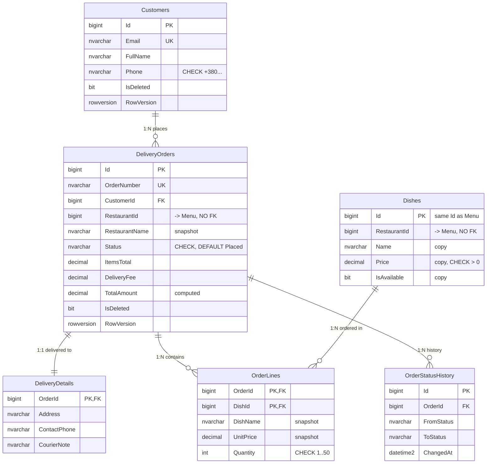
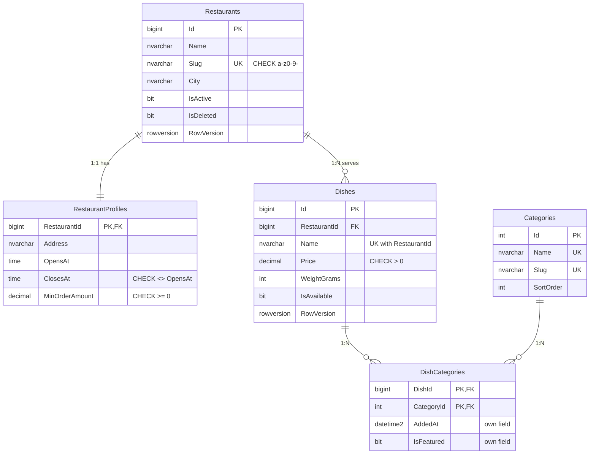

# ERD-діаграми

### Проєкт №1 — `SmakoViz_Delivery`

**M:N** `DeliveryOrders ↔ Dishes` реалізовано проміжною таблицею `OrderLines` з двома FK (складений PK).

### Проєкт №2 — `SmakoViz_Menu`

**M:N** `Dishes ↔ Categories` — через проміжну **сутність** `DishCategories` з власними полями `AddedAt` і `IsFeatured`.

### Проєкт №3 — MongoDB `smakoviz_feedback`

| Колекція | Прийом | Що всередині |
|----------|--------|--------------|
| `reviews` | **embedding** + **referencing** + гнучка схема | вбудовані `author{}` і `comments[]`; посилання `discussionId`, `orderId`, `restaurantId`, `dishId`; 3 типи відгуків з різними полями (`photos`, `aspects{}`, `courier{}`, `tags[]`) |
| `discussions` | **гібрид** | вбудовані 3 останні повідомлення `recentMessages[]` + лічильник; повна історія — у `messages` |
| `messages` | **referencing** | `discussionId` → `discussions._id` (повідомлень може бути тисячі) |
| `ratingSummaries` | денормалізований read-model | середні оцінки ресторанів, будується `aggregate(... $merge)` |

Приклади документів: [`docs/mongo-documents.md`](mongo-documents.md). 

## Індекси та під які запити вони створені

### SmakoViz_Delivery (db/p1/schema.sql)
| Індекс | Запит |
|--------|-------|
| `UQ_Customers_Email` | вхід / пошук клієнта за email |
| `UQ_DeliveryOrders_OrderNumber` | пошук замовлення за номером, який диктує клієнт |
| `IX_DeliveryOrders_Customer_Status` (фільтр `IsDeleted=0`, покриваючий) | «Мої замовлення» з фільтром за статусом, нові зверху |
| `IX_DeliveryOrders_Restaurant_Queue` (фільтр `Status IN (Paid, Cooking)`) | черга ресторану — що готувати зараз |
| `IX_DeliveryOrders_OnTheWay` (фільтр `Status = OnTheWay`) | диспетчер кур'єрів — замовлення в дорозі |
| `IX_OrderLines_DishId` | популярні страви / у яких замовленнях є страва |
| `IX_OrderStatusHistory_Order` | таймлайн статусів замовлення |
| `IX_Dishes_Restaurant_Available` (фільтр `IsAvailable=1`) | доступні страви ресторану з локальної копії |

### SmakoViz_Menu (db/p2/schema.sql)
| Індекс | Запит |
|--------|-------|
| `UQ_Restaurants_Slug` | сторінка ресторану за адресою `/restaurants/{slug}` |
| `UQ_Dishes_Restaurant_Name` | заборона двох однакових страв в одному ресторані |
| `IX_Dishes_Restaurant_Menu` (фільтр доступні й не видалені) | меню ресторану за назвою |
| `IX_Dishes_Name` | пошук страви за початком назви |
| `IX_DishCategories_Category` | страви категорії: спершу featured, потім нові |
| `IX_Restaurants_City` | активні ресторани міста |

### MongoDB smakoviz_feedback (db/p3/collections.js)
| Індекс | Запит |
|--------|-------|
| `ix_reviews_restaurant_created` | відгуки ресторану, нові зверху |
| `ix_reviews_dish_rating` (partial: є `dishId`) | найкращі відгуки на страву |
| `ix_reviews_author` | «Мої відгуки» |
| `ux_reviews_order_target` (unique, partial) | один відгук на ціль у межах замовлення |
| `tx_reviews_text` | повнотекстовий пошук |
| `ix_discussions_restaurant_activity` | найактивніші обговорення ресторану |
| `ix_messages_discussion_created` | історія обговорення з пагінацією |
